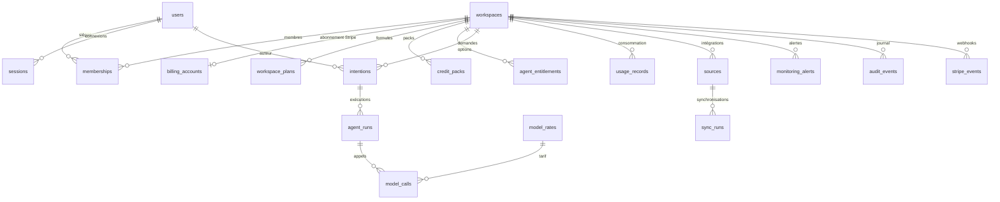

# LEKA ADMIN : audit technique de LEKA CORE (LEKA-542)

Audit de l'existant avant tout développement de LEKA ADMIN, la console interne de l'équipe LEKA. Il dit ce que LEKA CORE contient déjà (données, API, services), ce qui manque, les risques et l'architecture recommandée.

- **Lu** : le dépôt sur `main` au 2026-11-05 (commit `717a2e10`) : les modèles de données (118 tables), les 103 migrations, les 380 routes de l'API, les commandes internes, la documentation technique (`docs/`).
- **Non lu** : la base de production. Rien n'a été exécuté contre la production ; les volumes réels restent à mesurer (§ 12, prérequis).
- **Annexe** : [`tables-leka-core.md`](tables-leka-core.md), les 118 tables par domaine avec leurs relations, générée depuis le code.

## 1. En bref

1. **Les données existent pour l'essentiel** de LEKA ADMIN : organisations, comptes, membres, abonnements, coûts et crédits par appel au modèle, exécutions d'agents, intentions, intégrations, alertes, journal d'audit. Il faut les exposer, pas les créer.
2. **Aucun accès « tous clients » n'existe dans l'API, par construction.** Chaque lecture est enfermée dans l'espace de la personne connectée, par un garde-fou qui refuse toute requête non bornée. Les 21 permissions valent toutes pour un seul espace, et il n'y a pas de rôle « équipe LEKA ».
3. **L'administration existe déjà, en ligne de commande sur le serveur** : comptes, organisations Enterprise, formules, packs de crédits, coûts, rapports internes, usage par appel. Ce sont les premiers services que LEKA ADMIN doit réutiliser.
4. **Pas de Supabase.** La base de LEKA est PostgreSQL 16 (avec pgvector) sur AWS RDS, pilotée par SQLAlchemy et Alembic. Il n'y a ni vue, ni fonction métier, ni politique de sécurité au niveau des lignes (RLS) ; l'isolation entre clients est dans le code. Supabase n'est qu'un connecteur proposé aux clients.
5. **Stripe ne garde localement que l'état de l'abonnement.** L'historique des factures, des paiements et des remboursements n'est pas stocké, seulement le journal des webhooks reçus. Un tableau de revenus (MRR, impayés) demande soit de lire Stripe, soit de stocker les factures.
6. **L'activité est partielle.** Les connexions sont dans le journal d'audit (365 jours par défaut), les exécutions et coûts dans `usage_records` et `model_calls`. Les sessions expirées sont purgées et il n'existe pas d'historique d'activité quotidienne : les mesures d'usage et de rétention (actifs par jour, cohortes) demandent un événement de plus.
7. **Les crédits ne sont pas un registre de transactions.** Ils se recalculent : coût des appels au modèle ÷ prix d'un crédit, plus les packs ajoutés, contre l'allocation de la formule. LEKA-553 demande un vrai registre (attribution, consommation, remboursement, ajustement, expiration) : c'est la plus grosse donnée à créer.
8. **Recommandation** : un module `admin` côté API (routes `/api/v1/admin/*`, réservées à une identité « équipe LEKA » distincte, en lecture seule d'abord, chaque accès inscrit dans un journal d'audit dédié), qui réutilise les services existants. Côté interface, l'application Android LEKA ADMIN (Ionic React et Capacitor, LEKA-543), dont les paquets partagés serviront ensuite à la version web sur `backoffice.leka-core.com`.

## 2. Architecture de LEKA CORE

| Couche | Ce qu'elle est |
| --- | --- |
| Interface | Next.js (App Router), TypeScript, Tailwind, TanStack Query ; `web/` ; types de l'API générés (`web/lib/api-types.ts`) |
| API | FastAPI, Python 3.12, SQLAlchemy 2 asynchrone ; `api/leka/` ; 380 routes en 26 domaines |
| Travail de fond | files Redis (RQ) et un bus d'événements en base (`events`, `job_runs`) ; tâches planifiées (`leka/platform/scheduler.py`) |
| Données | PostgreSQL 16 + pgvector (AWS RDS, privé) ; stockage objet S3 chiffré pour les données brutes des sources et les pièces jointes |
| Modèles de langage | une passerelle unique (`leka/capabilities/gateway`) : chaque appel est tracé (`model_calls`), coûté (`model_rates`) et compté en crédits |
| Paiement | Stripe (Checkout, portail client, webhooks) ; catalogue dans `api/leka/billing/catalogue.yaml` |
| Déploiement | une machine EC2 (Docker Compose, Caddy), CI et CD GitHub Actions sur un exécuteur auto-hébergé, sauvegarde nocturne |

Le code est découpé en modules à frontières contrôlées par un test (`api/tests/test_module_boundaries.py`) : un module bas ne lit jamais un module haut. Les modules qui comptent pour LEKA ADMIN :

| Module | Ce qu'il porte |
| --- | --- |
| `platform` | organisations (`workspaces`), membres, invitations |
| `identity` | comptes, sessions, jetons d'e-mail, commandes d'administration des comptes |
| `billing` | compte de facturation Stripe, options achetées, journal des webhooks, statistiques de la page Tarifs |
| `metering` | consommation par exécution, avertissements de crédits, rapports internes |
| `governance` | rôles et permissions, politiques, journal d'audit, formules attribuées, packs de crédits |
| `capabilities` | agents et capacités, leurs exécutions, appels aux modèles, tarifs des modèles, modèles propres d'une organisation |
| `intentions` | intentions, analyses, décisions, plans, vérifications |
| `connectors`, `ingestion` | intégrations (sources), synchronisations, données collectées |
| `monitoring`, `notifications` | alertes, revues de nuit, notifications |
| `background` | bus d'événements, tâches et leurs tentatives |
| `ops` | sauvegardes, organisations Enterprise, métriques Prometheus |

## 3. La base de données

- **Moteur** : PostgreSQL 16 avec pgvector, en développement dans Docker, en production sur RDS.
- **Schéma** : 118 tables, gérées par 103 migrations Alembic (`alembic check` en CI).
- **Conventions** : identifiants UUID, `created_at` et `updated_at` partout. 107 tables portent `workspace_id` et suppriment en cascade avec leur organisation.
- **Isolation entre clients** (`leka/db/repository.py`) : faite dans le code, à deux niveaux.
  - Les dépôts de données reçoivent l'organisation à leur construction.
  - Un garde-fou de session intercepte chaque requête sur une table rattachée à une organisation : il la borne, ou il refuse sans organisation déclarée. Le refus est explicite, jamais un résultat vide silencieux.
  - Seul `system_scope()` (tâches de fond, migrations, seed) peut traverser les organisations, et il se déclare en une ligne visible.
- **Ni vues, ni fonctions métier, ni RLS.** Les seules fonctions SQL sont 12 déclencheurs : 11 empêchent de modifier ou d'effacer une ligne de journal (« ajout seulement » : `audit_events`, `access_decisions`, `intention_events`, `agent_run_events`, etc.), le douzième empêche de réécrire un tarif de modèle (`model_rates`).
- **Rétention** (`docs/data-lifecycle.md`) :

| Donnée | Gardée |
| --- | --- |
| journal d'audit | 365 jours par défaut, réglable par organisation entre 90 jours et 7 ans |
| sessions | jusqu'à expiration ou révocation, puis purgées chaque heure |
| événements du bus | 14 jours par défaut (`event_retention_days`) |
| données brutes des sources | 30 à 90 jours selon la source |
| historiques de traitement | 90 jours |
| historique des relations du modèle | 365 jours |
| organisation supprimée | effacée à la fin de son délai de grâce |

## 4. Authentification et permissions

**Comptes et sessions** (`leka/identity`) :

- Comptes à e-mail et mot de passe, avec adresse confirmée par e-mail.
- Session par cookie (jeton haché en base) et protection CSRF.
- Durée de vie : absolue et d'inactivité, plus la case « se souvenir de moi ».
- Révocation d'une session ou de toutes.
- La session garde son organisation active, son navigateur (`user_agent`) et un préfixe d'adresse IP.

**Rôles et permissions** (`leka/governance`) :

- Trois rôles de base par organisation (propriétaire, administrateur, membre), plus des rôles propres à une organisation (LEKA-403).
- 21 permissions, toutes à l'échelle d'une organisation : `workspace:*`, `member:*`, `source:*`, `intention:*`, `context:manage`, `job:read`, `entity:*`, `access:read`, `policy:manage`, `audit:*` (détail dans `docs/permissions.md`).
- Les décisions d'accès sont gardées (`access_decisions`).

**Ce qui n'existe pas** : une identité « équipe LEKA ». Personne, dans l'API, ne peut lire deux organisations à la fois. Les seules routes qui regardent toute la plateforme sont `GET /ops/metrics` (métriques Prometheus) et `GET /ops/health` (état de chaque composant) : elles demandent un jeton technique (`LEKA_METRICS_TOKEN`), pas une personne, et ne rendent que des chiffres agrégés, aucune donnée de client.

**L'administration d'aujourd'hui**, en commandes sur le serveur :

| Commande | Ce qu'elle fait |
| --- | --- |
| `python -m leka.identity.admin accounts` / `grant` | lister les comptes et leurs organisations ; donner l'accès à une organisation |
| `python -m leka.ops.enterprise provision` / `show` | créer ou mettre à jour une organisation Enterprise (instructions, agent dédié) |
| `python -m leka.metering.cli plan` / `plans` | mettre une organisation sur une formule (avec auteur et raison, audité) ; son historique |
| `python -m leka.metering.cli pack` | ajouter des crédits au mois (avec auteur et raison, audité) |
| `python -m leka.metering.cli credits` / `workspaces` | crédits d'une organisation ; toutes les organisations et leur formule |
| `python -m leka.metering.cli report` | rapports internes : agents, intentions, organisations, formules (coût, marge), gaspillage, contexte |
| `python -m leka.metering.cli usage` | chaque appel au modèle, filtrable et agrégeable (le « backoffice » de LEKA-530) |
| `python -m leka.metering.cli compare` / `rates` / `sweep` / `intention` | comparer deux périodes ; tarifs des modèles ; recalcul ; coût d'une intention |
| `python -m leka.billing.cli stripe-sync` / `grant-agents` | pousser le catalogue dans Stripe ; donner tous les agents à une organisation |
| `python -m leka.capabilities.suggestions list` / `set-status` | les suggestions d'agents des clients et leur suivi |
| `python -m leka.ops.backup dump` / `verify` | sauvegarde et vérification |

## 5. Cartographie des entités

| Entité | Tables | Champs utiles à l'admin | Relations |
| --- | --- | --- | --- |
| **Organisation** | `workspaces` | nom, slug, statut, `suspended_at`, `deletion_requested_at`, `demo`, réglages, langue, création | parent de toutes les tables « espace » |
| Organisation Enterprise | `workspace_plans` (formule `enterprise`, crédits du contrat), `dedicated_agents`, `workspace_models` | formule, crédits contractuels, agent dédié, modèle propre | `workspace_id` |
| **Utilisateur / profil** | `users` | e-mail, confirmé le, dernière connexion, échecs de connexion, prénom, nom, entreprise, poste, taille d'entreprise, langue, région | membre de 0 à n organisations |
| Session | `sessions` | organisation active, vue la dernière fois, expiration, révocation, navigateur, préfixe IP | `user_id`, `active_workspace_id` |
| **Membre** | `memberships`, `invitations`, `role_assignments`, `workspace_roles` | rôle, depuis quand ; invitations (statut, expiration, qui a invité) ; rôles propres | `user_id` ↔ `workspace_id` |
| **Intention** | `intentions` (+ `intention_events`, `_analyses`, `_decisions`, `_plans`, `_verifications`, `_attachments`) | texte, titre, type, statut et date de changement, auteur, archivage | `created_by` → `users` |
| **Exécution** | `agent_runs` (+ `agent_run_events`), `skill_runs`, `workflow_runs` (+ étapes, événements), `code_changes`, `job_runs` | agent ou capacité, version, statut, demandé par, intention, modèle, durées, erreur ; pour le code : dépôt, PR, CI, déploiement | `intention_id`, `requested_by` → `users` |
| **Appel au modèle** | `model_calls`, `llm_runs`, `model_rates` | finalité, fournisseur, modèle, tokens, coût en dollars au tarif du jour, latence, statut, personne | `run_id`, `user_id`, `rate_id` |
| **Agent / capacité** | fichiers `agents/` (registre), `capability_registrations`, `workspace_capabilities`, `agent_entitlements`, `dedicated_agents`, `capability_suggestions` | catalogue et versions ; activé ou non par organisation ; options achetées (Stripe, période, origine) ; suggestions des clients | `workspace_id` |
| **Crédits** | `usage_records`, `model_calls`, `workspace_plans`, `credit_packs`, `credit_warnings` | consommation par exécution (tokens, coût LEKA, coût client, appels, échecs, nouvelles tentatives) ; formule et allocation ; packs ajoutés ; seuils franchis | voir § 7 |
| **Facturation** | `billing_accounts`, `add_on_checkouts`, `stripe_events`, `agent_entitlements` | client et abonnement Stripe, formule, cadence, statut, fin de période, résiliation prévue, offre de lancement utilisée, dernière facture ; journal de chaque webhook et de son traitement | `workspace_id` |
| **Intégration** | `sources` (+ `source_events`, `source_settings`, `source_credentials` chiffrés), `sync_runs`, `source_syncs`, `webhook_deliveries` | type, nom, statut, santé, dernière erreur, dernière synchronisation ; chaque passage (volumes, erreur) | `created_by` → `users` |
| **Incident** | entités `incident` du modèle (`entities`, venant des outils des clients), `monitoring_alerts`, `night_reviews` | incidents des clients et alertes de LEKA chez eux ; **aucune table pour les incidents de la plateforme LEKA elle-même** | `workspace_id` |
| **Événement** | `events` (bus), `audit_events`, `notifications`, `intention_events`, `capability_events`, `site_events` | ce qui s'est passé, qui, sur quoi, résultat ; `site_events` : clics de la page Tarifs, anonymes | `workspace_id` (sauf `site_events`) |

## 6. Activité, connexions, rétention

| Besoin | Disponible | Limite |
| --- | --- | --- |
| dernière connexion d'un compte | `users.last_login_at` | une seule date, pas d'historique |
| historique des connexions | `audit_events` (`user.signed_in`, `user.signed_out`, `user.password_changed`, `user.session_revoked`, `user.account_closed`), copiées dans chaque organisation du compte | soumis à la rétention de chaque organisation (365 jours par défaut) ; rien pour un compte sans organisation |
| sessions en cours | `sessions` (vue la dernière fois, navigateur, préfixe IP) | les sessions expirées sont purgées chaque heure |
| activité dans le produit | `intentions`, `agent_runs`, `usage_records` et `model_calls` par personne et par jour ; `audit_events` par action | aucun suivi des pages vues ; pas d'agrégat quotidien |
| actifs par jour, semaine, mois ; cohortes ; rétention | reconstructible seulement à partir des actions (intentions, exécutions, connexions auditées) | **à instrumenter** (§ 10) |
| inscription et entonnoir | `users.created_at`, `email_verified_at`, première adhésion (`memberships.created_at`), première source (`sources.created_at`), première intention | pas d'étape d'activation nommée ; pas de source d'acquisition |
| page Tarifs | `site_events` (vue, cadence choisie, formule choisie, clic d'appel à l'action), anonymes | non reliés au compte créé ensuite |

## 7. Stripe et la facturation

**Ce qui est stocké** :

- **`billing_accounts`**, une ligne par organisation : client et abonnement Stripe, formule, cadence, statut, fin de période, résiliation à la fin de période, offre de lancement utilisée, dernière facture (son identifiant), date d'application.
- **`agent_entitlements`** : chaque option (agent ou bundle) avec son abonnement Stripe, sa période, son origine (achat, formule, contrat, attribution par LEKA), qui et pourquoi.
- **`add_on_checkouts`** : les paiements d'options en cours ou terminés.
- **`stripe_events`** : chaque webhook reçu, son type, son organisation, le traitement fait et son détail. Les événements traités sont `checkout.session.completed` et `async_payment_succeeded`, `customer.subscription.*`, `invoice.paid`, `invoice.payment_failed`, `charge.refunded`.
- **`workspace_plans`** et **`credit_packs`** : les formules et crédits donnés à la main par l'équipe LEKA, avec auteur et raison.

**Ce qui n'est pas stocké** :

- l'historique des factures (montants, taxes, réductions, statut) ;
- les paiements et les remboursements (montants) ;
- les moyens de paiement ;
- le chiffre d'affaires récurrent mensuel (MRR) et son évolution ;
- les coupons.

Ces données sont dans Stripe. Un tableau de revenus doit les lire (API Stripe, avec mise en cache) ou les stocker à la réception des webhooks déjà écoutés, l'option recommandée (§ 11).

**Les coûts sont, eux, complets côté LEKA.** Chaque appel au modèle a son coût en dollars, au tarif du jour (`model_rates`, jamais réécrit), et la commande `report plans` calcule déjà la marge par formule, au prix catalogue et au prix promotionnel.

## 8. API et services réutilisables

| Pour LEKA ADMIN | À réutiliser |
| --- | --- |
| liste et fiche des organisations | `Workspace`, `leka.metering.cli workspaces`, `credits_now()` (`leka/metering/credits.py`), `plan_of()` (`leka/governance/plans.py`) |
| comptes et membres | `leka/identity/admin.py` (lister, donner accès), les services de `platform` (membres, invitations), `GET /auth/sessions` (logique de lecture des sessions) |
| formules, packs, contrats | les commandes `plan`, `pack` (`leka/metering/cli.py`), `leka/ops/enterprise.py` ; l'historique `plans` |
| consommation, coûts, marges | `leka/metering` : `report` (agents, intentions, organisations, formules, gaspillage, contexte), `usage`, `compare`, `intention` |
| abonnements et options | `GET /billing/subscription`, `/billing/entitlements`, `/billing/add-ons` (logique), `leka.billing.cli grant-agents` |
| exécutions et intentions | les dépôts de `capabilities` et `intentions` (`GET /agent-runs`, `/agent-runs/journal`, le coût d'une intention) |
| intégrations | les services de `connectors` (état, santé, synchronisations) |
| alertes et incidents | `GET /monitoring` (logique), `monitoring_alerts`, `night_reviews` |
| journal | `AuditTrail` (`leka/governance/audit.py`) : recherche, export, rétention |
| santé de la plateforme | `GET /ops/metrics` (Prometheus), `GET /ops/health`, `job_runs` (tâches échouées, en retard) |
| suggestions des clients | `leka/capabilities/suggestions.py` (`list`, `set-status`) |

Les routes existantes ne se réutilisent pas telles quelles : elles lisent l'organisation de la session. Ce qui se réutilise, ce sont les **services et dépôts** derrière elles, appelés pour une organisation donnée (`workspace_scope(id)`) ou pour toutes (`system_scope()`).

## 9. Matrice fonctionnalité, données disponibles, données manquantes

Une ligne par ticket du backlog LEKA ADMIN (LEKA-542 à LEKA-559, epics LEKA-534 à LEKA-541). « Disponible » : ce que LEKA CORE a déjà et que le ticket réutilise. « Manquant » : ce qu'il faut créer.

| Ticket | Disponible dans LEKA CORE | Manquant | Dépend de |
| --- | --- | --- | --- |
| **542** Audit | ce document | rien | aucun |
| **543** Socle Ionic React, Capacitor, paquets partagés | conventions du dépôt (`AGENTS.md`, Conventional Commits, CI), jetons de marque de `web/` (`--brand-navy`, `--brand-violet`), types générés depuis l'OpenAPI, `GET /api/v1/health` pour tester la liaison | le dépôt LEKA ADMIN, la chaîne Android, les paquets `shared-ui`, `business-logic`, `api-client`, `types`, `validation` | aucun |
| **544** Admin API | les services de chaque module (§ 8) ; `workspace_scope()` et `system_scope()` ; la pagination signée (`leka/db/pagination.py`) ; le format d'erreur (`leka/core/errors.py`) ; l'identifiant de corrélation `X-Request-ID`, déjà gardé dans `events`, `audit_events`, `job_runs`, `model_calls` ; l'idempotence (`events.dedupe_key`, `stripe_events.event_id` unique) ; les événements de connexion, d'intention, d'exécution, de consommation et d'intégration | le module `admin` et ses routes ; un événement d'inscription (`user.signed_up`) et de création d'organisation (`workspace.created`) : aujourd'hui seulement `created_at` ; les paiements avec leur montant | 545 |
| **545** Authentification admin, RBAC | les méthodes de `leka/identity` (mot de passe haché, jeton de session haché, expiration, révocation, compteur d'échecs, jetons de réinitialisation par e-mail) ; le moteur de permissions de `leka/governance/policy.py` | les comptes `admin_users`, les rôles Super Admin, Operations, Support, Finance et leurs permissions par module et par action, la dépendance `AdminPrincipal`, la connexion forte, la gestion des accès par le Super Admin | 544 |
| **546** Sessions, sécurité, Audit Logs | la durée de vie et la révocation des sessions ; `user.sign_in_failed` et le verrouillage ; le modèle des journaux en ajout seulement (12 déclencheurs) ; la rétention réglable et l'export (`AuditTrail`) | `admin_sessions` ; `admin_audit_events` en ajout seulement, avec sa propre rétention ; la trace des consultations sensibles et des exports ; le stockage du jeton dans le magasin sécurisé d'Android | 545 |
| **547** Design system et interface mobile | les jetons de marque et les icônes de `web/` ; la règle des dictionnaires `fr` et `en` | les composants partagés et mobiles ; la navigation Accueil, Clients, Utilisateurs, Activité, Plus ; leurs états chargement, vide, erreur, succès | 543 |
| **548** Dashboard global | acquisition (`workspaces.created_at`, `users.created_at`, formule par organisation) ; intentions et analyses par statut ; adoption des agents (`agent_runs`) ; consommation IA (`usage_records`) ; intégrations en erreur (`sources.health_status`) ; traitements en échec (`job_runs`, `processing_runs`) ; nombre de nouveaux abonnements, résiliations et paiements échoués par type d'événement Stripe (`stripe_events`) | DAU, WAU, MAU (activité quotidienne) ; MRR et ARR (montants) ; incidents de la plateforme ; cohortes ; conversion Free vers payant (l'historique des formules Stripe est écrasé dans `billing_accounts`) ; activation et Time to First Value se calculent des premières dates (première source, première intention, premier livrable) | 544, 553, 554, § 10 |
| **549** Organisations, fiche 360° | nom, `id` et `slug`, e-mail du propriétaire (siège `owner` puis `users.email`), création, formule, statut et `suspended_at`, nombre de membres et d'intentions ; **suspension et réactivation déjà écrites** (`suspend`, `reactivate` de `leka/platform/service.py`, sans route) ; ajout de crédits avec motif (`credit_packs`, audit `workspace.credits_added`) ; alertes (`monitoring_alerts`) | le pays (aucun champ : `users.region` est la région d'affichage d'une personne) ; la taille (déclarée par personne, `users.company_size`, pas par organisation) ; la dernière activité (à calculer) ; les notes internes ; l'historique des actions de l'équipe LEKA | 544, 545, 546, 553 |
| **550** Utilisateurs | nom, e-mail, organisation, rôle, inscription, dernière connexion (`last_login_at`), nombre d'intentions ; « invité » (`invitations` en attente) ; connexions et échecs dans l'audit de chaque organisation ; agents utilisés et consommation par personne (`agent_runs.requested_by`, `usage_records.user_id`) | un statut « suspendu » pour un compte (aucun champ) ; le niveau d'activité et la classification actif / inactif (activité quotidienne) ; un historique des connexions indépendant de la rétention de chaque organisation | 544, § 10 |
| **551** Intentions et analyses | tout : `intentions` (texte, titre, type, résumé, 12 statuts), analyses, choix des agents (`capability_routings`), exécutions et leurs étapes, décisions et plans (actions proposées), erreurs, chronologie (`intention_events`), consommation par intention | la correspondance documentée des 12 statuts de LEKA vers les 5 de LEKA ADMIN (en attente, en cours, terminée, échouée, annulée) ; la liste transversale et ses index ; la trace des consultations sensibles | 544, 546 |
| **552** Agents et performance | les 31 agents du registre (`agents/registry.yaml`) et leurs versions ; utilisations, organisations, réussites et échecs, durées (`agent_runs`) ; coût par appel au tarif du jour (`model_calls`, `model_rates` : sans tarif, le coût reste inconnu, jamais 0) ; `report agents` ; revenus traçables des options achetées (`agent_entitlements` et prix du catalogue) | rien de bloquant. La liste du ticket (QA, Architect, DevOps, Lead, Growth, Security, Data, Product, Research, Finance) est indicative : Lead, Growth, Product, Research et Finance n'existent pas dans LEKA CORE ; le module montre les agents réels | 544 |
| **553** IA Credits et registre | allocation (formule, `workspace_plans.monthly_credits`), packs, consommation (`usage_records`), solde calculé (`credits_now()`), ventilation par agent et par modèle, coût fournisseur (`llm_cost_usd`, `leka_cost_usd`), seuils (`credit_warnings`) | **le registre** `credit_transactions` (type, quantité, origine, référence d'opération unique, auteur) ; la notion de remboursement ; l'écriture des expirations en fin de mois ; la réconciliation avec `usage_records` | 544, 546 |
| **554** Stripe, abonnements, finance | webhook signé et idempotent (`stripe_events.event_id` unique) ; état de l'abonnement (`billing_accounts`) ; options (`agent_entitlements`) ; formules Free, Starter, Growth, Business, Enterprise et prix du catalogue ; offre de lancement ; erreurs de traitement (`stripe_events.outcome`) | factures, paiements, remboursements avec leurs montants ; l'historique des changements d'abonnement ; coupons et promotions ; MRR et ARR et leur réconciliation avec Stripe | 544 |
| **555** Environnements et intégrations | sources (statut, santé, dernière erreur, dernière synchronisation) ; échecs de synchronisation (`sync_runs`, `source_syncs.consecutive_failures`) ; services détectés (`entities`) ; relations avec leur origine (dite, déduite, acceptée), leur confiance et leur provenance (LEKA-532) ; une quarantaine de connecteurs dont GitHub, Jira, Confluence, AWS, Supabase ; secrets chiffrés, jamais rendus | la vue transversale à toutes les organisations | 544 |
| **556** Monitoring, incidents, notifications | intentions échouées, exécutions en erreur, sources en erreur, synchronisations échouées, seuils de crédits, paiements échoués (`stripe_events`), tâches en échec (`job_runs`), métriques Prometheus ; le modèle de dédoublonnage des alertes clients (`monitoring_alerts`) | `admin_incidents` (catégorie, gravité critique, élevée, moyenne, faible ; statut nouveau, en cours, résolu, fermé ; responsable ; historique ; clé de dédoublonnage) ; le centre de notifications de l'équipe ; un registre des erreurs d'API (aujourd'hui métriques et journaux seulement) | 544, 545 |
| **557** Recherche globale, filtres, exports | recherche plein texte par organisation (`entities.search_vector`) ; export du journal ; index unique sur l'e-mail ; les tâches de fond pour les exports longs (`job_runs`) | les index de recherche transversale (organisations, intentions, transactions, incidents) ; les exports asynchrones et leur trace | 544, 546 |
| **558** QA et audit sécurité | pytest et couverture, `test_tenant_isolation`, `test_module_boundaries`, Playwright, la CI | les tests propres à l'admin (RBAC, isolation, journaux) ; les tests Android ; la recherche de secrets dans l'APK | tous |
| **559** APK signé, documentation web | rien côté LEKA CORE | identifiant d'application, icône, écran de démarrage, versionnage, clé de signature gardée hors du dépôt ; le guide de la version web (`backoffice.leka-core.com`, hors périmètre) | 543, 547 |

## 10. Événements à instrumenter

Événements à ajouter, chacun avec son organisation, sa personne et son horodatage, dans le bus existant (`events`) ou dans le journal (`audit_events`). Ceux que LEKA-544 liste et qui existent déjà : connexion, intentions, exécutions d'agents, consommation, intégrations.

0. **Inscription et organisation** : `user.signed_up`, `workspace.created` ; aujourd'hui seule la date de création les dit.
1. **Activité quotidienne** : `user.active_day` (un par compte, organisation et jour) ; la base des actifs par jour, semaine et mois, et des cohortes.
2. **Activation** : `workspace.first_source_connected`, `workspace.first_intention`, `workspace.first_agent_run`, `workspace.first_deliverable` ; l'entonnoir d'inscription.
3. **Facturation** : `billing.invoice_recorded` (montant, taxes, statut), `billing.payment_failed`, `billing.refund_recorded`, `billing.plan_changed` (avant et après), `billing.subscription_canceled` (motif si donné), stockés à la réception des webhooks déjà écoutés.
4. **Crédits** : chaque mouvement du registre de LEKA-553 (attribution, consommation, remboursement, ajustement, expiration), avec sa référence d'opération pour l'idempotence.
5. **Équipe LEKA** : `admin.signed_in`, `admin.viewed` (organisation, ressource, motif), `admin.acted` (action, avant et après), `admin.impersonation_started` et `_ended`.
6. **Plateforme** : `platform.incident_opened`, `_updated`, `_resolved` (périmètre, sévérité, organisations touchées).
7. **Acquisition** : relier la visite de la page Tarifs (`site_events`) au compte créé, si le consentement le permet.
8. **Retour sur les agents** : `agent_run.rated` (utile ou non, commentaire), pour mesurer la satisfaction par agent.

## 11. Risques, dépendances, doublons

| Risque | Pourquoi | Parade |
| --- | --- | --- |
| Fuite entre clients | l'admin lit par nature toutes les organisations ; une route mal bornée exposerait tout | un module `admin` à part, sa propre identité, `system_scope()` seulement là, lecture seule par défaut, chaque lecture journalisée ; tests de non-régression de l'isolation |
| Compte « équipe LEKA » compromis | il ouvre toutes les organisations | connexion forte obligatoire, sessions courtes, liste fermée de comptes, alerte sur chaque connexion |
| Actions sur l'argent | changer une formule, ajouter des crédits, rembourser | motif obligatoire, double validation pour les montants, tout dans le journal de l'équipe |
| Performances | 107 tables par organisation ; les vues transversales parcourent tout | index par date et statut, agrégats quotidiens (relevés, activité), pagination stricte |
| Données Stripe à deux endroits | stocker les factures crée une copie | Stripe reste la vérité ; la copie ne sert qu'à l'affichage, rejouable depuis les webhooks (`stripe_events`) |
| Doublons avec l'existant | le « backoffice » de LEKA-530 (`metering.cli usage`), les rapports internes, les commandes `plan` et `pack`, l'organisation Enterprise | LEKA ADMIN appelle ces services, il ne les réécrit pas ; les commandes restent pour l'exploitation |
| Rétention trop courte | connexions effacées avec le journal d'une organisation ; sessions purgées | un historique d'activité propre à LEKA ADMIN, avec sa durée annoncée |
| RGPD | l'admin voit des données personnelles (noms, e-mails, préfixes IP) | finalité écrite, accès par rôle, journal des consultations, durées de conservation documentées |
| Dépendance au déploiement | une seule machine, une seule base | l'admin n'ajoute pas de charge lourde aux heures de pointe (agrégats calculés la nuit) |

**Dépendances** : identité et connexion de l'équipe LEKA avant tout ; relevés de crédits et stockage des factures avant les tableaux financiers ; événement d'activité quotidienne avant les mesures d'engagement ; table des incidents de plateforme avant leur suivi.

## 12. Recommandations d'architecture et prérequis

**Architecture recommandée** :

1. **Un module `api/leka/admin`**, avec ses routes sous `/api/v1/admin/*`.
   - Il dépend des modules existants, jamais l'inverse : le test de frontières l'impose.
   - Ses lectures passent par les services existants, en `workspace_scope(id)` pour une organisation, `system_scope()` pour une vue transversale.
   - Ses écritures (formule, pack, statut) passent par les mêmes fonctions que les commandes d'aujourd'hui.
2. **Une identité « équipe LEKA » distincte des clients.**
   - Une table de comptes internes avec les quatre rôles de LEKA-545 : Super Admin, Operations, Support, Finance.
   - Une connexion forte et des sessions courtes. Pour l'application Android, un jeton porté en en-tête et gardé dans le magasin sécurisé du téléphone, pas un cookie : aucun secret de LEKA dans l'APK.
   - Une dépendance FastAPI `AdminPrincipal`, différente de `Principal`, pour qu'aucune route client ne l'accepte et inversement.
3. **Un journal de l'équipe LEKA** (`admin_audit_events`), en ajout seulement comme les autres journaux, indépendant de la rétention des clients.
4. **Des agrégats calculés par les tâches de fond**, plutôt que des requêtes lourdes à la volée : relevé mensuel des crédits, activité quotidienne, chiffres par organisation.
5. **Une interface séparée**, d'abord **l'application Android** (Ionic React et Capacitor, dépôt LEKA ADMIN, LEKA-543). Ses paquets partagés (`shared-ui`, `business-logic`, `api-client`, `types`, `validation`) ne dépendent pas d'Android et serviront à la version web sur `backoffice.leka-core.com` (LEKA-559, hors périmètre). Jamais dans la navigation des clients.
6. **Lecture seule au premier lot.** Les actions (formules, crédits, consultation « en tant que ») arrivent ensuite, une par une, chacune avec motif et journal.

**Prérequis avant développement** :

- [x] Le backlog des 18 tickets rattaché à la matrice (§ 9), ligne par ligne.
- [ ] La liste des personnes de l'équipe LEKA et de leurs rôles, et la méthode de connexion forte retenue.
- [ ] La décision sur les factures Stripe : les stocker depuis les webhooks (recommandé) ou les lire à la demande.
- [ ] Les volumes réels de production (organisations, comptes, exécutions par jour, taille des tables), mesurés par une requête en lecture faite par l'équipe d'exploitation, pour dimensionner index et agrégats.
- [ ] La validation RGPD : finalité, données affichées, durées de conservation, information des clients sur l'accès de l'équipe LEKA.
- [ ] Les contrats d'API du premier lot, écrits et validés à partir des § 5, 8 et 9 : liste et fiche d'organisation, comptes, consommation et crédits, abonnements.
