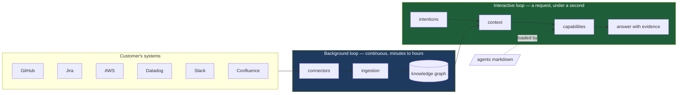
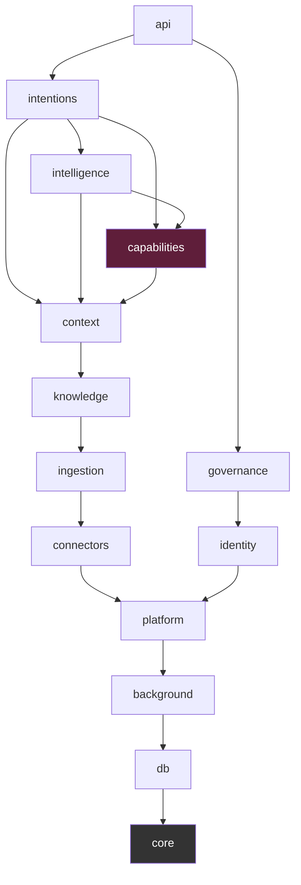
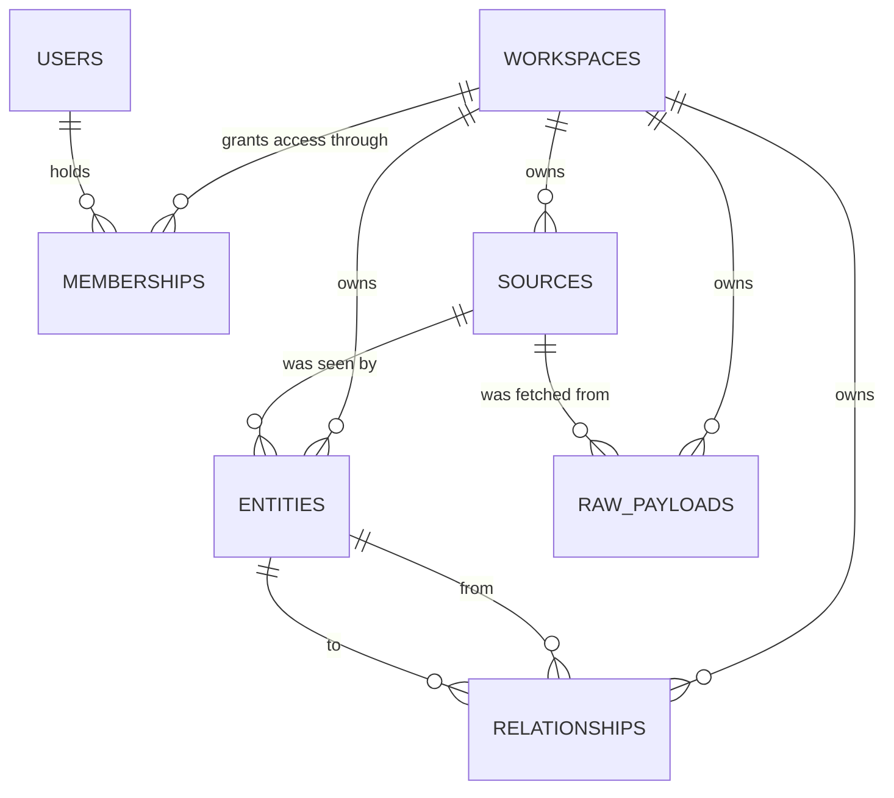
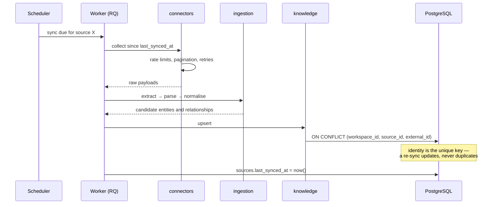
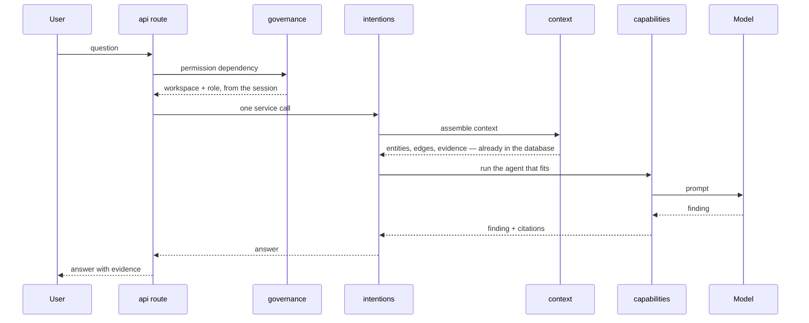
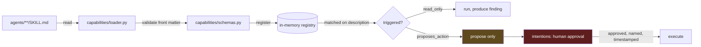

# LEKA architecture

The reference for how LEKA is put together: what the pieces are, what each is
responsible for, where the boundaries run, and what is not allowed to cross
them.

This document is normative. When the code and this file disagree, one of them
is a bug — say which in the pull request.

**Status:** the foundation is in place — configuration, database layer,
schema, health, CI. Most modules are still boundaries rather than code; the
table in section 2 says which is which, honestly. A boundary decided before
the code is written is the point of this document, not a gap in it.

---

## 1. What LEKA does

LEKA connects to a company's information system — GitHub, Jira, Confluence,
AWS, Datadog, Slack — keeps a continuously updated map of its architecture,
and answers operational questions with evidence. "Why did payment service
latency blow up?" is the kind of question it is built for.

### The one decision everything else follows from

**The expensive work happens in the background, continuously. Not when the
user asks.**

LEKA is not a RAG system that queries a dozen APIs while the user waits. By
the time a question arrives, the graph is already built, already normalised,
already ranked. The interactive path reads prepared state.

This has consequences that show up everywhere in this document:

- Two loops, not one, with different latency budgets and different failure
  modes.
- A source of truth that lives in our database, not in the vendor APIs.
- Freshness as a property we track (`last_seen_at`, `confidence`) rather than
  assume.
- An answer that can cite where each piece of evidence came from, because the
  evidence was collected and attributed long before the question.



---

## 2. Components and responsibilities

The backend is a **modular monolith**: one deployable, hard internal
boundaries. See [ADR 002](adr/002-modular-monolith.md) for why, and for what
would make us reconsider.

Every module has the same internal shape. This is not decoration — it means
any developer opening any module knows where to look.

| File | Holds | May not |
| --- | --- | --- |
| `models.py` | SQLAlchemy tables | contain business rules |
| `schemas.py` | Pydantic types crossing the boundary | mirror the tables by reflex |
| `repository.py` | **every** database query in the module | decide anything |
| `service.py` | the business logic | write SQL |
| `__init__.py` | what other modules may import | re-export internals wholesale |

### The modules

`Built` means the module exists and does its job. `Skeleton` means the
boundary is defined and the files are in place, empty. `Planned` means it
exists only in this document — the boundary is decided, the code is not
written.

| Module | Responsibility | Depends on | State |
| --- | --- | --- | --- |
| `core` | settings, exceptions, FastAPI dependencies, logging | nothing | built |
| `db` | engine, session, declarative base, column mixins, tenant scope guard | `core` | built |
| `background` | the background loop's machinery: events (an outbox), the job queue, and later job runs and their scheduling. Below `platform` so that platform can use it | `core`, `db` | **LEKA-334** — events, job runs, the queue and its schedule; see [background.md](background.md) |
| `platform` | tenancy (workspaces, memberships, invitations), the LEKA-330 seam, secrets, health | `core`, `db` | tenancy, seam and secrets built |
| `identity` | who someone is, and which workspaces they may enter | `core`, `db`, `platform` | **LEKA-330** |
| `connectors` | talking to customer systems; one subpackage per system | `core`, `db`, `platform` | `sources` built, no connector yet |
| `ingestion` | collect → extract → parse → normalise | ← `connectors` | skeleton |
| `knowledge` | the company model: canonical entities and relationships, their registry, versions, lifecycle and provenance; traversal; its course — snapshots, what it was at a moment, restores and rebuilds kept | ← `ingestion` | **LEKA-361** — built from enrichment; its course (**LEKA-383**); see [company-model.md](company-model.md) |
| `context` | retrieval, ranking, assembly of what an answer needs: contexts, their versions, each element's provenance; retrievers combined — graph, words, the records' text, time, paths | ← `knowledge`, `ingestion` (the records' text) | **LEKA-370**, **LEKA-371**, **LEKA-372**, **LEKA-373**, **LEKA-374**, **LEKA-375**, **LEKA-376** — the context engine, its retrieval, its ranking, what an intention asks of it, how it keeps up with the model (told by `knowledge.model_built`), how good it is, and its API; see [context.md](context.md), [context-api.md](context-api.md) |
| `intentions` | intention → decision → action, with approval: what was asked, its lifecycle, its history — append-only, the database refusing to rewrite it — and its links | ← `intelligence`, `context`, `knowledge` | **LEKA-384** — the intention, its lifecycle and history; its analysis — LEKA's capabilities run on its context, each isolated, the result kept with its evidence (**LEKA-388**); what it asks to do put to people's decision under the workspace's policy, every vote kept (**LEKA-390**); what was approved carried out through the systems the workspace authorized, signed, or by a person — checked first, its evidence kept (**LEKA-391**); whether it achieved what was expected, read from the model and the system that acted, the company's context rebuilt when it did — and its whole story in one timeline (**LEKA-392**); see [intentions.md](intentions.md) |
| `intelligence` | what LEKA concludes from what it knows: analyses over the company model and the contexts, run when the model is built, hourly and on demand — each isolated, versioned; every run and step kept; findings kept across runs with their evidence and provenance | ← `capabilities`, `context`, `knowledge` | **LEKA-377** to **LEKA-383** — the engine and its first rule analyses (told by `knowledge.model_built`); which changes matter and what they reach; what LEKA does not know, or no longer knows, and which gap first; what the model lacks, proposed and applied once validated — the facts kept in leka.knowledge (`model_assertions`), which the build applies; what the sources disagree on, weighed by their authority and settled by someone (**LEKA-382**); how far what LEKA knows can be trusted (**LEKA-381**); what the model's course says, and what happened, for Activité (**LEKA-383**); see [intelligence.md](intelligence.md) |
| `capabilities` | **the only module that calls a language model**; what LEKA can do — its catalogue — and the agents it loads and runs | `knowledge`, `context`, `connectors`, `governance` | agent loader; **LEKA-393** — the catalogue: every capability, LEKA's own and the agents, one model — contract, needs, lifecycle, versions kept, whether each can be used here and why not, discovered for routing; see [capabilities.md](capabilities.md); **LEKA-394** — the model gateway and router: one provider contract (Google Gemini by default, Mistral, OpenAI or compatible, Azure OpenAI, Anthropic), routing by what a task needs, retries and fallbacks, structured output and tools, every call kept with its cost; a workspace's own model; see [model-gateway.md](model-gateway.md); **LEKA-395** — the agent runtime: an agent run through a common runtime — its context injected, read-only tools offered by the permissions of who asked, every run and step kept; see [agent-runtime.md](agent-runtime.md); **LEKA-429** — the LLM runtime every feature has a model work through: its LEKA context, its answer checked before use, every execution kept, a model never acting; see [llm-runtime.md](llm-runtime.md); **LEKA-398** — the capability router: an intention routed to the capabilities that fit it, ranked by defined signals (its goal, kind, words, what it is about, its context), the unavailable and the unauthorized excluded, LEKA's analysis as fallback or what to ask, every decision kept; see [capability-router.md](capability-router.md); **LEKA-397** — the workflow engine: capabilities composed into ordered, conditional, multi-step runs — failures handled and retried from where they failed, versions in the catalogue, every run, step and event kept; see [workflows.md](workflows.md); **LEKA-400** — the enterprise agent library: eleven agents (architecture, code review, security, tests, debug, documentation, incident, infrastructure, data, release, build fixer), each to the runtime's contract, declaring its tools, routed to; see [agent-library.md](agent-library.md); **LEKA-396** — skills: the operations capabilities are made of, each with its contract (pydantic in and out), versioned by its fingerprint, run through one runtime — permission, input and output checked, read only as the database holds it, every run kept; LEKA's reads are the first, the analyst's tools; see [skills.md](skills.md); **LEKA-401** — the enterprise skill library: ten skills, one per domain (repository, code review, testing, security, documentation, architecture, incidents, infrastructure, data, delivery), each judging what the model holds into signals; named by agents, composed by workflows, called by the analyst; see [skills.md](skills.md) § 9 |
| `governance` | permissions, the request principal, audit | `platform`, `identity` | permissions built, audit skeleton; **LEKA-406** — AI controls: model access, usage limits, output checks, approval of risky agents, enforced at the model gateway and where an agent is asked to run, every outcome kept; see [ai-governance.md](ai-governance.md); **LEKA-407** — the audit trail: one record per event that matters, in one shape, searched, exported, kept as the owner says, changed by no one; see [audit.md](audit.md) |
| `ops` | operations (LEKA-408): metrics, the health report, the alerts, backups proven to restore | every module, as operating data | see [operations.md](operations.md) |
| `api` | HTTP routes, one file per module | all of the above | health + 11 tenancy routes; other routers mounted and empty |

### The dependency rule



**Dependencies point one way only:**

```
intentions → intelligence → context → knowledge → ingestion → connectors
```

`connectors` knows nothing about the graph. `knowledge` knows nothing about
how a question is answered. An arrow in the other direction is not a shortcut,
it is the beginning of a system where nothing can be changed without changing
everything.

**A module is imported only through its `__init__.py`.** Reaching into
`leka.knowledge.repository` from another module couples you to a decision that
module is entitled to change without telling you.

> This rule is not enforceable by a linter. We tried: Ruff's banned-import
> check is per-file, so exempting a module's own directory also exempts it
> when it reaches into everyone else's. It is enforced instead by
> `api/tests/test_module_boundaries.py`, which reads the import graph and
> checks the direction as well as the depth. It caught two violations in this
> document's own foundation on the day it was written.

---

## 3. Data model

Two generic tables carry the graph. Not one table per kind of object. See
[ADR 003](adr/003-entity-model.md).



**`entities`** — every object LEKA knows about, discriminated by `type`
(`service`, `repository`, `incident`, `deployment`, `person`, `document`,
`infra_resource`, `database`). Specifics live in `attributes` (JSONB).

**`relationships`** — directed edges, typed (`depends_on`, `owns`,
`deployed_to`, `mentions`, `caused_by`, `member_of`).

Both carry `confidence` and entities carry `last_seen_at`. LEKA infers things;
an answer built on shaky evidence has to be able to say so.

**`raw_payloads`** — what a connector actually fetched, before anything was
made of it. THE BYTES ARE NOT IN THIS TABLE: the row holds a key, a size, a
SHA-256 and an expiry, and the payload itself lives in an object store. They
are the largest volume in the product and the shortest-lived, and keeping them
here would swell every backup and lengthen every restore. See
[ADR 010](adr/010-object-storage.md), and
[docs/data-lifecycle.md](data-lifecycle.md) for how long anything is kept and
what happens when a customer leaves.

**`source_syncs`** — how far each capability of each source has been read:
the cursor the next incremental pass starts from (when the last successful
one started), how many records it brought, how many passes in a row failed
and why. One row per (source, capability); the sync of LEKA-352 writes it.

**`sync_runs`** — what each pass over a source did: what started it, whether
it read in full, when it ran, how far it got batch by batch, how it ended.
The pass that fetched a payload is the run whose times hold its fetch
(LEKA-353).

**`source_records`** — the per-record index: what was seen of each vendor
object, with its checksum, by which run, in which batch, and whether it is
gone. What deduplicates, what knows deletions and scope removals. Not an
entity — an issue may make several or none — and never written by
leka.knowledge's side.

### Tenancy

Every customer shares the same tables. **Every business table carries
`workspace_id NOT NULL` with a foreign key.**

Two tables are exceptions, both deliberate:

- **`workspaces`** — it *is* the tenant.
- **`users`** — a person is a person. A consultant working for two customers
  signs in once. Which workspaces they may enter, and as what, is recorded in
  `memberships`, and that table is the authority.

**The workspace never comes from a URL or a request body.** It is read from
the session, server side. A client that can name its own workspace is a client
that can name someone else's. `POST /workspaces/{id}/switch` is the single
exception and is not really one: it verifies a membership and then writes the
id into the server's own session — a client may ASK to move, never ASSERT
where it is. See [ADR 007](adr/007-tenant-isolation-strategy.md).

A test enumerates every mounted route and requires each to be protected or
listed as deliberately public with a written reason, so a route added
without authentication fails CI rather than shipping. See
[ADR 011](adr/011-api-conventions.md) and [docs/api.md](api.md).

That rule is a discipline, so we do not rely on it alone. Reads are filtered
by a session-level scope guard that refuses any query touching a
workspace-scoped table with no workspace declared, and cross-tenant
references are made **structurally impossible** by composite foreign keys:

```sql
FOREIGN KEY (workspace_id, source_id)
    REFERENCES sources (workspace_id, id)
```

A plain `source_id` foreign key would happily accept another tenant's source.
This one cannot: the row is rejected by PostgreSQL. The same pattern pins both
ends of every relationship, so an edge can never join two customers' graphs.

---

## 4. The two loops

### Background loop — the expensive one

Runs continuously in an RQ worker. Minutes to hours. Nobody is waiting.



A source that fails does not stop the others. Its `status` becomes `error`,
its last good data stays in the graph, and answers built on it carry the
staleness in `last_seen_at`.

### Interactive loop — the one with a user in front of it

A single HTTP request. Budget: under a second up to the model call.



Note what does **not** happen here: no call to GitHub, no call to Datadog. The
context was assembled by the other loop, hours ago.

**A route validates, calls one service, and returns.** Over fifteen lines, the
logic is in the wrong place. Permissions are a FastAPI dependency, never an
`if` in a route body — an `if` is forgotten in the fourteenth route by someone
in a hurry.

---

## 5. Agents

An agent is a **markdown file with YAML front matter**, not a Python class.
See [ADR 004](adr/004-agents-as-markdown.md).

Consequences: agents are versioned in Git, reviewed in pull requests, and
adding one requires no deployment.



**`agents/` holds content. `capabilities/` holds the loader.** Never the other
way round.

Two rules, without exception:

1. **Agents run read-only.** An agent in `proposes_action` mode proposes. It
   never executes. Execution goes through `intentions` after explicit, named,
   timestamped human approval.
2. **An agent is text that becomes an instruction executed by a model with
   access to a customer's production data.** Anything placed in
   `agents/vendor/` is reviewed line by line in a pull request before it is
   activated.

---

## 6. Constraints

### Technical

| Constraint | Why |
| --- | --- |
| Python 3.12 exactly | pinned dependencies; 3.13 untested |
| PostgreSQL 16 with pgvector | one database for relational, JSONB and vectors — [ADR 001](adr/001-postgresql.md) |
| Async everywhere in the API | the workload is IO-bound: databases and HTTP |
| Redis + RQ for the background loop | a queue we can reason about with two part-time developers |
| No secret in Git, ever | credentials are Fernet-encrypted before they reach the database; the key lives in the environment — [ADR 005](adr/005-credential-storage.md) |

### Human

**Two part-time developers.** This is an architectural constraint, not an
aside. It rules out anything needing a dedicated operator: no Kubernetes, no
Kafka, no service mesh, no separate graph database. Every component here is
one someone can debug alone on a Friday evening.

### The twelve rules

Every change is held to them. They are listed in
[conventions.md](conventions.md).

---

## 7. What is deliberately absent

| Not here | Why |
| --- | --- |
| Microservices | [ADR 002](adr/002-modular-monolith.md). Module boundaries first; process boundaries only if one part genuinely needs to scale apart |
| A graph database | the graph is narrow and workspace-scoped. PostgreSQL with the right indexes handles it. Adding Neo4j means a second store to keep consistent |
| An orchestration framework | `capabilities` is a few hundred lines we control, against a dependency that moves faster than we do |
| A `shared/` package | a drawer where coupling goes to hide. Something used by two modules belongs to one of them, or to `platform` |
| A README in every folder | they rot. The module docstring sits next to the code and is read during review |
| Offset pagination | [ADR 011](adr/011-api-conventions.md). Rows arrive while somebody reads, so page two repeats or loses items |
| A general filter syntax | a standing invitation to query something nobody meant to expose. Filters are declared per resource |
| A separate API gateway | our gateway is FastAPI. Request ids and rate limiting are two middlewares, not a component to operate |
| Payload bytes in PostgreSQL | [ADR 010](adr/010-object-storage.md). The largest and least durable data we hold, in the store that is hardest to back up and restore |
| Partitioned tables | `raw_payloads` will need it. Not yet — the triggers are written down as numbers in [ADR 010](adr/010-object-storage.md), and the quarterly restore drill is what observes them |
| A scheduler of our own | `rq cron`, which ships with RQ, puts the periodic sweeps on the queue from a table in `leka.background.schedule`. Every task is still a plain function with a synchronous entry point, safe to run twice; the schedule decides when, not how. See [background.md](background.md) |
