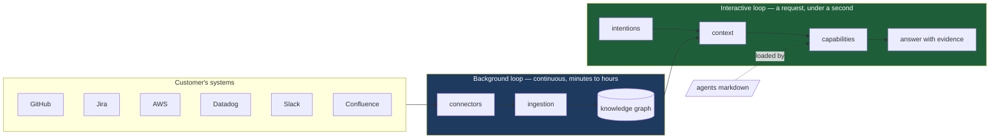
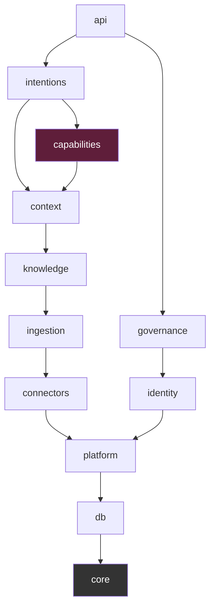
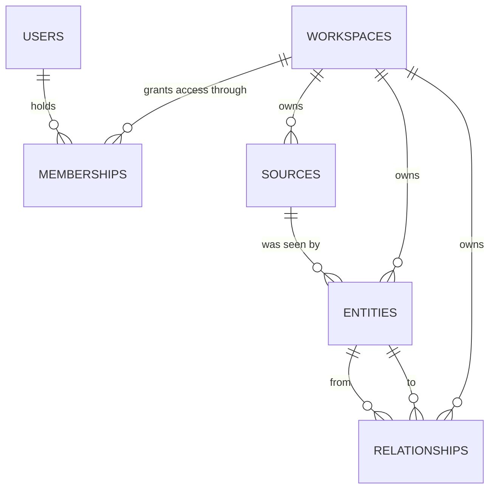
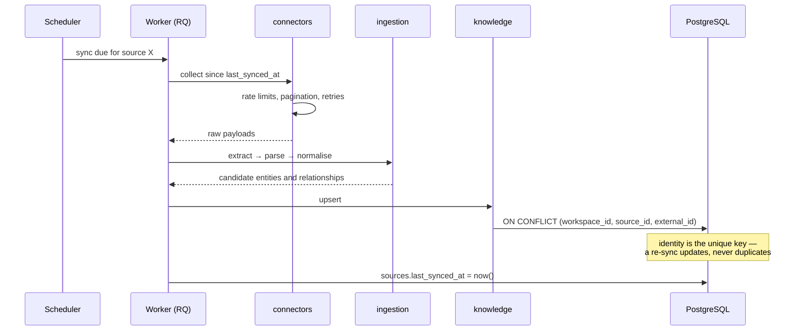
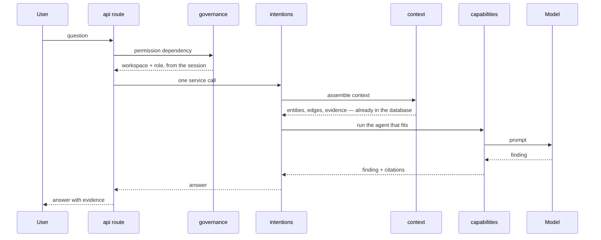
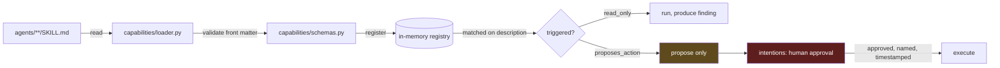

# LEKA architecture

The reference for how LEKA is put together: what the pieces are, what each is
responsible for, where the boundaries run, and what is not allowed to cross
them.

This document is normative. When the code and this file disagree, one of them
is a bug — say which in the pull request.

**Status:** the foundation is in place — configuration, database layer,
schema, health, CI. Most modules are still boundaries rather than code; the
table in section 2 says which is which, honestly. A boundary decided before
the code is written is the point of this document, not a gap in it.

---

## 1. What LEKA does

LEKA connects to a company's information system — GitHub, Jira, Confluence,
AWS, Datadog, Slack — keeps a continuously updated map of its architecture,
and answers operational questions with evidence. "Why did payment service
latency blow up?" is the kind of question it is built for.

### The one decision everything else follows from

**The expensive work happens in the background, continuously. Not when the
user asks.**

LEKA is not a RAG system that queries a dozen APIs while the user waits. By
the time a question arrives, the graph is already built, already normalised,
already ranked. The interactive path reads prepared state.

This has consequences that show up everywhere in this document:

- Two loops, not one, with different latency budgets and different failure
  modes.
- A source of truth that lives in our database, not in the vendor APIs.
- Freshness as a property we track (`last_seen_at`, `confidence`) rather than
  assume.
- An answer that can cite where each piece of evidence came from, because the
  evidence was collected and attributed long before the question.



---

## 2. Components and responsibilities

The backend is a **modular monolith**: one deployable, hard internal
boundaries. See [ADR 002](adr/002-modular-monolith.md) for why, and for what
would make us reconsider.

Every module has the same internal shape. This is not decoration — it means
any developer opening any module knows where to look.

| File | Holds | May not |
| --- | --- | --- |
| `models.py` | SQLAlchemy tables | contain business rules |
| `schemas.py` | Pydantic types crossing the boundary | mirror the tables by reflex |
| `repository.py` | **every** database query in the module | decide anything |
| `service.py` | the business logic | write SQL |
| `__init__.py` | what other modules may import | re-export internals wholesale |

### The modules

`Built` means the module exists and does its job. `Skeleton` means the
boundary is defined and the files are in place, empty. `Planned` means it
exists only in this document — the boundary is decided, the code is not
written.

| Module | Responsibility | Depends on | State |
| --- | --- | --- | --- |
| `core` | settings, exceptions, FastAPI dependencies, logging | nothing | built |
| `db` | engine, session, declarative base, column mixins | `core` | built |
| `platform` | tenancy (workspaces), events, task queues, secrets, object storage | `core`, `db` | tenancy and health probes built, rest skeleton |
| `identity` | who someone is, and which workspaces they may enter | `core`, `db`, `platform` | **LEKA-330** |
| `connectors` | talking to customer systems; one subpackage per system | `core`, `db`, `platform` | `sources` built, no connector yet |
| `ingestion` | collect → extract → parse → normalise | ← `connectors` | skeleton |
| `knowledge` | the entity graph: entities, relationships, traversal | ← `ingestion` | tables built, traversal planned |
| `context` | retrieval, ranking, assembly of what an answer needs | ← `knowledge` | skeleton |
| `intentions` | intention → decision → action, with approval | ← `context` | skeleton |
| `capabilities` | **the only module that calls a language model**; loads and runs agents | `knowledge`, `context` | agent loader built, model gateway skeleton |
| `governance` | permissions and audit | `platform`, `identity` | skeleton |
| `api` | HTTP routes, one file per module | all of the above | `/health` only; one empty router per module, mounted |

### The dependency rule



**Dependencies point one way only:**

```
intentions → context → knowledge → ingestion → connectors
```

`connectors` knows nothing about the graph. `knowledge` knows nothing about
how a question is answered. An arrow in the other direction is not a shortcut,
it is the beginning of a system where nothing can be changed without changing
everything.

**A module is imported only through its `__init__.py`.** Reaching into
`leka.knowledge.repository` from another module couples you to a decision that
module is entitled to change without telling you.

> This rule is not enforceable by a linter. We tried: Ruff's banned-import
> check is per-file, so exempting a module's own directory also exempts it
> when it reaches into everyone else's. It is enforced instead by
> `api/tests/test_module_boundaries.py`, which reads the import graph and
> checks the direction as well as the depth. It caught two violations in this
> document's own foundation on the day it was written.

---

## 3. Data model

Two generic tables carry the graph. Not one table per kind of object. See
[ADR 003](adr/003-entity-model.md).



**`entities`** — every object LEKA knows about, discriminated by `type`
(`service`, `repository`, `incident`, `deployment`, `person`, `document`,
`infra_resource`, `database`). Specifics live in `attributes` (JSONB).

**`relationships`** — directed edges, typed (`depends_on`, `owns`,
`deployed_to`, `mentions`, `caused_by`, `member_of`).

Both carry `confidence` and entities carry `last_seen_at`. LEKA infers things;
an answer built on shaky evidence has to be able to say so.

### Tenancy

Every customer shares the same tables. **Every business table carries
`workspace_id NOT NULL` with a foreign key.**

Two tables are exceptions, both deliberate:

- **`workspaces`** — it *is* the tenant.
- **`users`** — a person is a person. A consultant working for two customers
  signs in once. Which workspaces they may enter, and as what, is recorded in
  `memberships`, and that table is the authority.

**The workspace never comes from a URL or a request body.** It is read from
the session, server side. A client that can name its own workspace is a client
that can name someone else's.

That rule is a discipline, so we do not rely on it alone. Cross-tenant
references are made **structurally impossible** by composite foreign keys:

```sql
FOREIGN KEY (workspace_id, source_id)
    REFERENCES sources (workspace_id, id)
```

A plain `source_id` foreign key would happily accept another tenant's source.
This one cannot: the row is rejected by PostgreSQL. The same pattern pins both
ends of every relationship, so an edge can never join two customers' graphs.

---

## 4. The two loops

### Background loop — the expensive one

Runs continuously in an RQ worker. Minutes to hours. Nobody is waiting.



A source that fails does not stop the others. Its `status` becomes `error`,
its last good data stays in the graph, and answers built on it carry the
staleness in `last_seen_at`.

### Interactive loop — the one with a user in front of it

A single HTTP request. Budget: under a second up to the model call.



Note what does **not** happen here: no call to GitHub, no call to Datadog. The
context was assembled by the other loop, hours ago.

**A route validates, calls one service, and returns.** Over fifteen lines, the
logic is in the wrong place. Permissions are a FastAPI dependency, never an
`if` in a route body — an `if` is forgotten in the fourteenth route by someone
in a hurry.

---

## 5. Agents

An agent is a **markdown file with YAML front matter**, not a Python class.
See [ADR 004](adr/004-agents-as-markdown.md).

Consequences: agents are versioned in Git, reviewed in pull requests, and
adding one requires no deployment.



**`agents/` holds content. `capabilities/` holds the loader.** Never the other
way round.

Two rules, without exception:

1. **Agents run read-only.** An agent in `proposes_action` mode proposes. It
   never executes. Execution goes through `intentions` after explicit, named,
   timestamped human approval.
2. **An agent is text that becomes an instruction executed by a model with
   access to a customer's production data.** Anything placed in
   `agents/vendor/` is reviewed line by line in a pull request before it is
   activated.

---

## 6. Constraints

### Technical

| Constraint | Why |
| --- | --- |
| Python 3.12 exactly | pinned dependencies; 3.13 untested |
| PostgreSQL 16 with pgvector | one database for relational, JSONB and vectors — [ADR 001](adr/001-postgresql.md) |
| Async everywhere in the API | the workload is IO-bound: databases and HTTP |
| Redis + RQ for the background loop | a queue we can reason about with two part-time developers |
| No secret in Git, ever | credentials are Fernet-encrypted before they reach the database; the key lives in the environment — [ADR 005](adr/005-credential-storage.md) |

### Human

**Two part-time developers.** This is an architectural constraint, not an
aside. It rules out anything needing a dedicated operator: no Kubernetes, no
Kafka, no service mesh, no separate graph database. Every component here is
one someone can debug alone on a Friday evening.

### The twelve rules

Every change is held to them. They are listed in
[conventions.md](conventions.md).

---

## 7. What is deliberately absent

| Not here | Why |
| --- | --- |
| Microservices | [ADR 002](adr/002-modular-monolith.md). Module boundaries first; process boundaries only if one part genuinely needs to scale apart |
| A graph database | the graph is narrow and workspace-scoped. PostgreSQL with the right indexes handles it. Adding Neo4j means a second store to keep consistent |
| An orchestration framework | `capabilities` is a few hundred lines we control, against a dependency that moves faster than we do |
| A `shared/` package | a drawer where coupling goes to hide. Something used by two modules belongs to one of them, or to `platform` |
| A README in every folder | they rot. The module docstring sits next to the code and is read during review |
