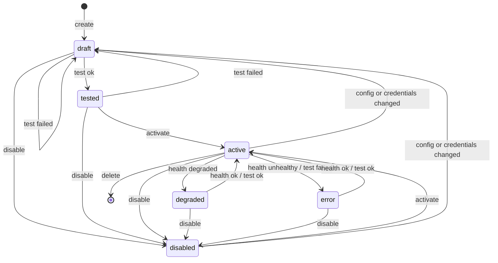

# The connector framework

How LEKA connects to a customer's systems — GitHub today, Jira, AWS and the
rest next — through one model. LEKA-344. The decisions behind it are in
[ADR 015](../adr/015-connector-framework.md); adding a connector is
[a tutorial of its own](adding-a-connector.md). What GitHub and GitLab ask
for and read: [code-platforms.md](code-platforms.md).

**LEKA only reads.** No connector writes to a customer's system: the
manifest says `read_only: True` as a literal, and every call a connector
makes is a GET.

---

## Two words

| | What it is | Where it lives |
|---|---|---|
| **Connector** | the code that knows one vendor — *GitHub* | `api/leka/connectors/<kind>/`, registered once |
| **Source** | one configured connection — *Acme's GitHub organisation* | a row in `sources`, per workspace |

The API follows them: `GET /connectors/catalog` lists connectors, `/sources`
holds a workspace's sources.

## The contract

```python
class Connector[ConfigT, CredentialsT](ABC):
    manifest: ClassVar[ConnectorManifest]   # key, category, schemas, capabilities
    async def test_connection(self) -> ConnectionTestResult   # auth + access + discovery
    async def check_health(self) -> HealthResult              # light, quota-free if possible
    def iter_resources(self, capability, *, since=None) -> AsyncIterator[RawRecord]
```

A connector receives its config and credentials **already validated and
decrypted**, and never touches the database. Every HTTP call goes through
`self.http()`: `httpx.AsyncClient`, 10 s per call, a transport the tests
replace. A whole connection test is bounded at **15 s** by the service.

`iter_resources` streams what a source holds for one capability, page by
page, as `RawRecord`s: the vendor's payload untouched, its stable
`external_id`, a `container` ("acme/api") and the vendor's `updated_at`.
`since` is `None` for an initial pass and, for an incremental one, when the
last successful pass started; a vendor that cannot filter by date returns
everything, and the sync engine keeps the latest version of each
`external_id`. A failure mid-stream raises `ConnectorError` — what was
yielded before stays valid. A connector that does not implement it raises
`NotImplementedError` and still exists; GitHub implements it (LEKA-345), the
engine that calls it is LEKA-352.

## Scope

What a source reads can be narrowed in its config — GitHub's
`repositories: ["acme/api", …]`; absent, everything the credentials see.
`list_scope()` offers the choices (at most 1 000, `truncated` beyond), so an
admin picks rather than types. The scope is config: changing it sends the
source back to `draft`, and the connection test then probes a repository
in scope, failing with `NOT_FOUND` if GitHub does not show it. Include and
exclude rules, and mapping, are LEKA-351.

## The lifecycle



- The whole table is `TRANSITIONS` in `leka/connectors/lifecycle.py`, and
  `next_status` is the only thing that writes `sources.status`. A pair not
  in the table is refused: **409 `conflict`**.
- **Activation needs a successful test of the settings the source has now.**
  The test stores a fingerprint of the config and of the credentials'
  *revision* (when they were set — never a hash of the secret). Changing
  either makes the fingerprint stale, and activation is refused until the
  next successful test.
- Changing config or credentials sends any source back to `draft`.
- Health moves only an activated source (`active`, `degraded`, `error`); it
  never activates one.

## Credentials

| | |
|---|---|
| Storage | `source_credentials`, one row per source, deleted with it (ON DELETE CASCADE) |
| Encryption | Fernet through `leka.platform.SecretBox`, keys in `LEKA_ENCRYPTION_KEYS` ([ADR 005](../adr/005-credential-storage.md)) |
| Key version | a 12-character fingerprint of the key that wrote the row — never the key |
| Interface | `SecretStore` (`put`, `open`, `describe`); today `DatabaseFernetSecretStore`, tomorrow KMS (LEKA-405) |
| API | **write-only**: accepted on create and on `PUT /credentials`, answered with a hint (`github_pat_…a1b2`) and `rotated_at` |

- Declared as `SecretStr` in each connector's credentials schema: a secret
  never shows in a `repr`, a log line, an exception or a response.
- Decrypted only when the service builds a connector, for one call. Nothing
  caches a plaintext.
- A key rotation (`scripts/rotate_encryption_key.py`) re-encrypts rows and
  updates their key version; it does not change `rotated_at`, so it does
  not force a retest.

## Diagnostics

Every failure is a `Diagnostic` (`leka/connectors/errors.py`), whatever the
vendor: stored as `sources.last_error`, returned by a failed test, written
into the history.

| Field | |
|---|---|
| `code` | stable, for programs |
| `retryable`, `retry_after` | whether and when to try again |
| `message`, `remediation` | for the admin, in French: what happened, what to do |
| `provider_status` | the vendor's HTTP status |
| `detail` | technical, **cleaned** of every configured secret and anything token-shaped |

| Code | Retryable | Typically |
|---|---|---|
| `AUTH_INVALID` | no | 401 |
| `AUTH_EXPIRED` | no | a vendor that says so |
| `PERMISSION_DENIED` | no | 403 |
| `INSUFFICIENT_SCOPE` | no | 403 "not accessible by personal access token" |
| `NOT_FOUND` | no | 404 on the configured organisation or project |
| `RATE_LIMITED` | yes | 403 with no quota left, or 429 |
| `TIMEOUT` | yes | no answer within 10 s (or the 15 s budget) |
| `NETWORK_UNREACHABLE` | yes | connection refused, DNS |
| `PROVIDER_ERROR` | yes | 5xx |
| `CONFIG_INVALID` | no | settings the connector refuses, no connector for the kind |
| `UNKNOWN` | yes | anything else |

**A failed test is an answer, not an error**: `POST /sources/{id}/test`
returns 200 with `ok: false` and the diagnostic.

## Health and sync

`health_status` (`unknown`, `healthy`, `degraded`, `unhealthy`),
`last_health_check_at` and `last_error` are set by `run_health_check` —
from `POST /sources/{id}/health-check`, and every fifteen minutes for
activated sources (`source-health` in `leka/background/schedule.py`).

`sync_status` (`never`, `idle`, `running`, `failed`) and `last_sync_at`
exist and are returned; the sync engine fills them (LEKA-352).

## History

`source_events` is append-only: `created`, `test_succeeded`, `test_failed`,
`activated`, `reconfigured`, `credentials_rotated`, `health_changed`,
`disabled`, `deleted`, with the actor and a payload that never holds a
secret. It has no foreign key to `sources`, so the deletion stays recorded.
Nothing is published on the event bus yet: the outbox marks an event nobody
consumes as failed, and nothing consumes these until LEKA-352.

## The API

Reading needs `source:read` (every member); everything else needs
`source:manage` (admins and owners). Another workspace's source is **404**.

| | |
|---|---|
| `GET /connectors/catalog` | connectors, manifests, JSON Schemas for the forms |
| `GET /sources` · `POST /sources` | list (paginated) · create in `draft` |
| `GET /sources/{id}` · `PATCH` · `DELETE` | read · rename or reconfigure · delete with its credential |
| `PUT /sources/{id}/credentials` | rotate the secret — back to `draft` |
| `POST /sources/{id}/test` · `/activate` · `/disable` | the lifecycle |
| `GET /sources/{id}/scope/options` | what the scope can be chosen from, asked of the vendor now — 200 with `ok: false` and a diagnostic when it refuses; 409 for a connector without a scope |
| `POST /sources/{id}/health-check` · `GET /health` | check now · last result |
| `GET /sources/{id}/events` | the history, paginated |

## What is not here

- **The sync engine** — LEKA-352: the job that calls `iter_resources`, keeps
  `since`, stores the records and fills the sync fields.
- **KMS / Secrets Manager** — LEKA-405: another `SecretStore`.
- **OAuth apps, GitHub App** — the MVP takes a fine-grained personal access token.
- **The Sources page** — the frontend reads the catalogue's JSON Schemas when it comes.
