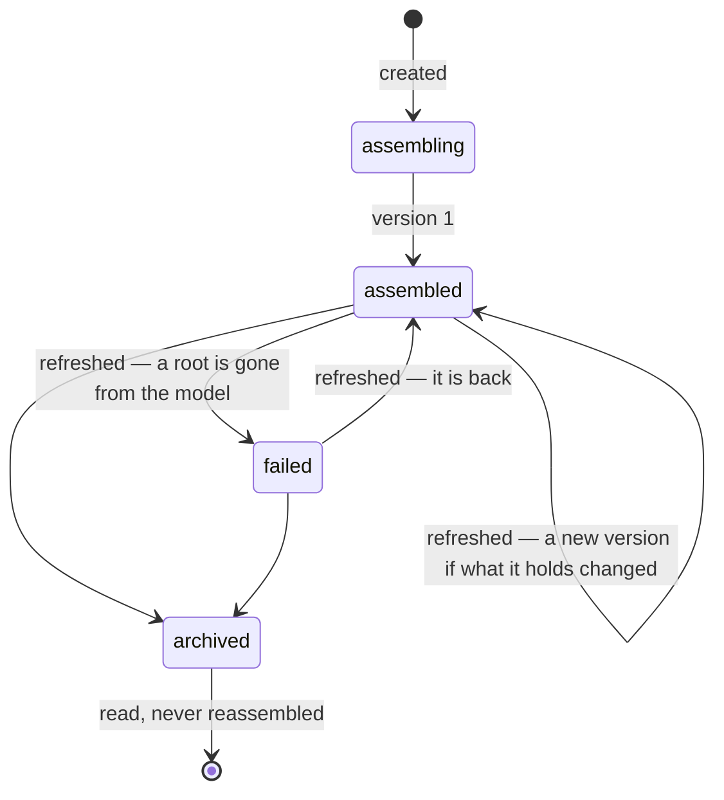

# The context engine — what LEKA assembles to understand a request

A question about the company — "why is Billing API slow?" — is not
answered from one source's records. It is answered from what the company
model says of Billing API and what surrounds it: what it depends on, what
depends on it, where it runs, who owns it, each piece with where it came
from. The context engine (`leka/context`, LEKA-370) assembles that, keeps
it version by version, and hands it to whatever analyses the request.

```
 sources ─▶ … ─▶ company model (leka.knowledge: entities, relationships, provenance)
                        │  GraphService.material(): a bounded walk, its provenance
                        ▼
 a request ─▶ context engine (leka.context) ─▶ a context, version 1, 2, …
               strategy → assembly → kept          each element: what it said,
                                                   where it came from, why it is there
                        │
                        ▼
              AssembledContext (contract v1) ─▶ intentions, capabilities (LEKA-384…)
```

It calls no customer API and no language model: by the time a request
arrives, the background loop has built the model ([architecture.md](architecture.md)).
It reads the model through `leka.knowledge` only (the dependency rule:
`intentions → context → knowledge`).

## 1. A context, its versions, its elements

| | Table | What it holds |
|---|---|---|
| **Context** | `contexts` | what it is for — a title, a `purpose` in the asker's words, a `subject` (an entity today, an intention with LEKA-384, or a bare request) — what it asks the model for (its **request**), where it stands (`status`), its latest version (`current_version`), who made it, when it was last checked (`refreshed_at`), archived when |
| **Version** | `context_versions` | one assembly, **never changed**: when, why (`trigger`: created or refreshed, and a `reason`), by which strategy and its version, under which contract, the request it answered, **which build of the model** it read (`model_built_at`, `model_version`), how many elements, whether the budget cut (`truncated`, `dropped`), counts (`summary`), a `fingerprint` of what it holds — or why it failed (`error`) |
| **Element** | `context_elements` | one thing a version holds — an entity or a relationship — at its `position`: its id and type in the model, a label, **what it said then** (`content`), **where it came from** (`provenance`), **why it is there** (`reason`), how relevant (`relevance`, empty until LEKA-372 ranks) |

**Kept whole, not as ids.** The model moves on: an attribute changes, a
relationship goes, an entity is removed. A version must say, months later,
what LEKA knew when it answered — so each element is a copy of what the
model said, not a pointer to what it says now.

The request a context answers:

| Field | | |
|---|---|---|
| `roots` | 1 to 10 entities | where it starts — the workspace's, or the context is refused (404) |
| `depth` | 1 to 3, default 1 | how many steps away |
| `relationships` | kinds, default all | only through these |
| `environment` | default all | only what is true in this one |
| `limit` | 1 to 500, default 100 | the budget: at most this many elements |
| `strategy` | `neighbourhood` | how the elements are gathered (§ 3) |

## 2. Its life



- **Created**: the request is settled, gathered and assembled; version 1 is
  written with its elements in the same transaction. A root that is not the
  workspace's refuses the whole thing — nothing is kept.
- **Refreshed**: assembled again from the model as it is now. If the result
  holds the same things, said the same way — **the same fingerprint** — no
  version is made: `refreshed_at` says it looked, and the latest version
  holds. Otherwise version N+1. Two refreshes at once wait for each other
  (the context row is locked), so they cannot both make N+1.
- **Failed**: a refresh that finds a root gone (or a strategy or kind of
  relationship LEKA no longer knows) makes a version that holds nothing and
  says why. The last version that held something is still what is read by
  default. Failing again the same way is no news: no new version.
- **Archived**: still read — every version — never reassembled (409).

## 3. How it is gathered: strategies

A strategy reads the model through `leka.knowledge` and hands back
**material**: entities, the relationships among them, each with its
provenance, the sources named, and which build of the model they came from
(`GraphService.material()`, [company-model.md § 16](company-model.md#16-the-knowledge-graph-search-walks-paths-views-leka-369)).
Each strategy has a name and a version, kept with every version it made.

| Strategy | Version | Gathers |
|---|---|---|
| `neighbourhood` | 1 | what surrounds the roots: a bounded walk, both ways, `depth` steps, through the kinds asked, in one environment or all — removed things never walked through, a removed root kept |

The baseline. LEKA-371 adds strategies beside it (by search, around an
incident's time, along the paths between two things), LEKA-373 chooses one
per kind of intention. A new strategy is a class with `name`, `version` and
`gather()` in `leka/context/strategies.py`, and one entry in `STRATEGIES`.

## 4. How it is assembled: order and budget

`leka/context/assembly.py`, pure — no database, no clock.

**The order is the budget's.** The roots first, as asked; then the
nearest, the surest, by name. Each entity taken brings, right after it,
the relationships between it and those already taken — a source's word
before a rule's, the surest first. So a context cut short holds what is
nearest and how it is tied, and **never a relationship whose end it
lacks**. What does not fit is dropped deliberately, counted (`dropped`)
and said (`truncated`) — also when the walk itself stopped short.

**Why each is there** (`reason`):

| `role` | Means | Also |
|---|---|---|
| `root` | asked for | `depth` 0 |
| `reached` | found from a root | `depth`, the `root`, and `via` — the relationship it was reached through, the surest way first |
| `tie` | a relationship between two elements | `depth`: its farther end's |

And every element carries `text`: itself in one line, for a model to read
— `service "Billing API" (service:billing-api) — tier: 1 [from Catalogue]`,
`"Checkout" depends_on "Billing API" — stated by Catalogue, confidence 0.90`.

## 5. Provenance: where each element came from

Copied from the model when the version is made:

| | Entity | Relationship |
|---|---|---|
| `origin` | `stated`: its sources show it | `stated` by a source's record, or `inferred` by an enrichment rule |
| `rule`, `confidence` | — , its confidence | the rule that inferred it, its confidence |
| `sources` | every source it goes by, with **its key there**; a source deleted since keeps its id and kind, no name | each source whose **record** stated it (`record_id`) |
| `evidence` | — | what the records said (`dependsOn`, `file:line — VAR`…) |
| `inferred_from` | — | the entities a rule read |
| `attributes` | each attribute's origin: a source, or an enrichment rule, its confidence and evidence | — |
| `conflicts` | what its sources disagree on, every value with who said it | — |
| `first_seen_at`, `last_seen_at`, `changed_at` | first and last seen | first seen, last changed |

**What an element is, across builds.** An entity keeps its id from build
to build (resolution's). A relationship does not: each build remakes the
relationships, their ids with them. So a relationship **is** its ends and
its kind (`assembly.identity()`): the fingerprint, the comparison of two
versions and `reason.via` are read through that, never through an id of
the day. And what changes with nothing said differently — being seen
again (`last_seen_at`, `changed_at`), a source renamed — is left out of
the fingerprint: the hourly model sweep does not make a version.

## 6. History: every version, as made

- **By number**: `GET /context/{id}/assembled?version=2`.
- **As it stood at a date**: `?at=2026-10-04T09:00:00Z` — the latest
  version that held something, made then or before. What LEKA knew when an
  incident started is one call.
- **What changed**: `GET /context/{id}/diff?from=1&to=2` — the elements
  added, the elements gone, and those said differently with **what** of
  them: `name`, `lifecycle`, `attributes.<name>`, `provenance.sources`,
  `reason`…

A version is never updated — refreshing writes a new one — so reading an
old one reads what it was, whatever the model became.

## 7. The contract downstream services read

`AssembledContext`, **contract version 1** (`CONTRACT_VERSION` in
`leka/context/schemas.py`): one version whole.

| Field | |
|---|---|
| `contract_version`, `context_id`, `version`, `status`, `error` | which, and whether it holds anything |
| `title`, `purpose`, `subject`, `request`, `strategy` | what it is for, what it asked, how it was gathered |
| `elements` | in order — each `{position, kind, ref_id, ref_type, label, entity \| relationship, provenance, reason, relevance, text}` |
| `sources` | the sources its elements came from, and how many each |
| `summary` | entities, relationships, stated and inferred, by type, by source kind |
| `truncated`, `dropped` | what the budget left out |
| `model_built_at`, `model_version`, `assembled_at` | from which build of the model, when |

In Python (intentions, capabilities):

```python
service = ContextService(ContextRepository(session, workspace_id),
                         GraphService(GraphRepository(session, workspace_id)))
made = await service.create(ContextCreate(title=..., purpose=..., roots=[...],
                                          subject=ContextSubject(type="intention", id=...)),
                            by=user_id)              # None: a root is not the workspace's
again = await service.assembled(made.context_id)     # the latest that holds something
then = await service.assembled(made.context_id, at=incident_started)
```

**The contract's rules.** A field added is no new contract; a field that
changes meaning or goes raises `CONTRACT_VERSION`, and each version keeps
the one it was made under. What a version stored is read back leniently —
strings, not the registry's enums; fields a later contract adds ignored —
so a snapshot stays readable after a kind is renamed.

## 8. The API and the screen

| Route | Permission | |
|---|---|---|
| `POST /context` | `intention:create` | a context assembled: version 1, whole (201); a root not the workspace's: 404 |
| `GET /context` | `intention:read` | the contexts, the latest changed first, paged — `status`, `subject_type`, `subject_id` |
| `GET /context/{id}` | `intention:read` | one, and its latest version |
| `POST /context/{id}/refresh` | `intention:create` | `{changed, version}`; archived: 409 |
| `POST /context/{id}/archive` | `intention:create` | archived; twice changes nothing |
| `GET /context/{id}/versions` | `intention:read` | its versions, the latest first, paged |
| `GET /context/{id}/assembled` | `intention:read` | one version whole: `?version=`, or `?at=`, or the latest that holds something; both: 400 |
| `GET /context/{id}/diff?from=&to=` | `intention:read` | what changed |

A member reads and makes contexts; a suspended workspace reads only
(`intention:create` is a write). The workspace is the session's; another
workspace's context is 404, and its entities cannot be roots. Fine-grained
access to contexts is LEKA-376.

**The screen**: an entity's sheet, tab **Contexte**
(`web/components/environment/entity-context.tsx`). With none yet, it
assembles one around the entity — why, how far. Then: what it is for, its
state and version, the figures (entities, relationships stated and
inferred, sources, left out), the elements in order — each with why it is
there and, opened, its provenance and what LEKA reads of it — the
versions, any one shown again, two compared; reassemble, archive, a new
context. Sized for a 13-inch screen: the list scrolls, the page does not.

## 9. Storage, size, speed

- Indexes: contexts by `(workspace, updated_at)` for the list and by
  `(workspace, subject_type, subject_id)` for a subject's; versions unique
  by `(context, version)`; elements by `(version, position)` to read a
  version in order, and by `(workspace, ref_id)` — which contexts used a
  thing, what LEKA-374 will refresh when it changes.
- **Tenancy is structural**: versions are tied to their context, elements
  to their version, by composite foreign keys on `(workspace_id, id)` — a
  row can never point into another workspace.
- Size: an element is its content and provenance as JSON — on LEKA's own
  model, a context of 31 elements weighs ~40 KB, of 74 ~90 KB. A version is
  written only when something changed.
- Speed — `scripts/bench_knowledge_graph.py`, 20 000 entities and 60 000
  relationships, PostgreSQL 16 on a laptop, median of 7:

| | ms |
|---|---:|
| context of a typical service, 1 step — assembled and kept | 27 |
| context of the busiest service, 2 steps, 500 elements — assembled and kept | 222 |
| a version of 500 elements, read back | 13 |
| refreshed, nothing changed | 83 |

- Kept as long as the workspace, like the model's own history
  ([data-lifecycle.md](data-lifecycle.md)); deleting the workspace deletes
  them.

## Not yet

- **Relevance** — `relevance` is empty: ranking against the purpose is
  LEKA-372; the order today is distance and confidence.
- **Other strategies** (LEKA-371) and a strategy per kind of intention
  (LEKA-373, LEKA-387).
- **Refreshing on its own** when the model changes (LEKA-374) — today a
  refresh is asked; `refreshed_at` and the elements' `ref_id` index are
  there for it.
- **A context's quality and confidence** as a whole (LEKA-375).
- **Fine-grained access and the full inspection API** (LEKA-376).
- **Intentions** as subjects (LEKA-384): the subject type exists, nothing
  makes one yet.
- A retention for contexts nobody reads: decided with LEKA-374, when
  contexts are made without being asked.
