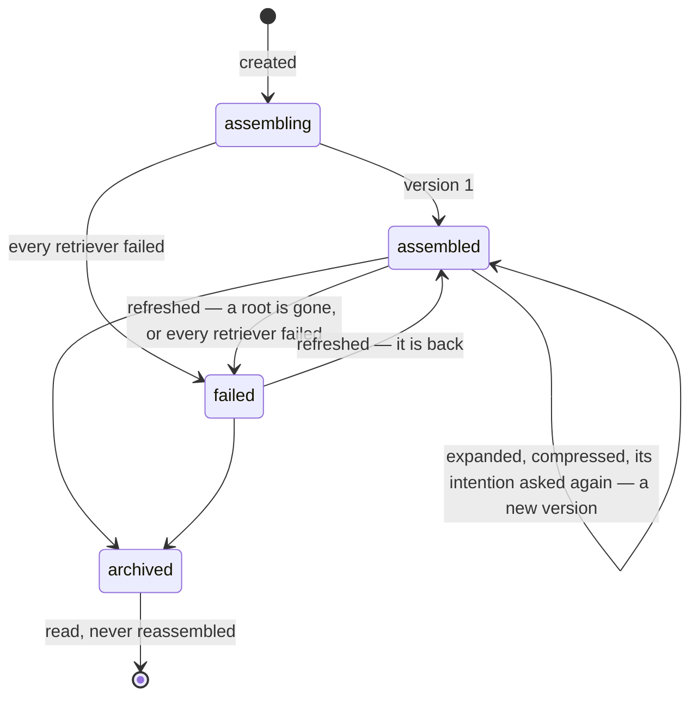

# The context engine — what LEKA assembles to understand a request

A question about the company — "why is billing slow?" — is not answered
from one source's records. It is answered from what the company knows of
billing and what surrounds it: the services it is, what they depend on,
what happened to them this week, the page that says how to recover them —
each piece with where it came from. The context engine (`leka/context`)
reads what an intention asks for — its kind, what it is about, when,
where, and what is missing (LEKA-373) — finds that (LEKA-371), ranks it —
what matters most first, duplicates folded, disagreements said (LEKA-372)
— assembles it, keeps it version by version (LEKA-370), keeps it up with
the company — behind the model said, made again where it is used,
widened, narrowed, asked again (LEKA-374) — judges how good it is —
complete, fresh, to be relied on, what it lacks, what it disagrees on and
how badly (LEKA-375) — and hands it to whatever analyses the request,
through a stable, versioned, guarded API (LEKA-376,
[context-api.md](context-api.md)).

```
 sources ─▶ … ─▶ company model (leka.knowledge)      records' own text (leka.ingestion)
                   entities, relationships,             extracted titles and bodies,
                   provenance, events                   indexed by their words
                        │                                        │
                        ▼                                        ▼
 an intention ─▶ read (kind, subjects, period, environment, gaps) ─▶ a request (§ 13)
                        │
                        ▼
 a request ─▶ retrievers: graph · search · content · timeline · paths ─▶ fused (relevance)
                        │
                        ▼
              ranking (topic × trust, duplicates folded, barely relevant left out, conflicts)
                        │
                        ▼
              assembly (order, budget, provenance, why) ─▶ a version, kept
                        │
                        ▼
              AssembledContext (contract v1) ─▶ intentions, capabilities (LEKA-384…)

 a build that changed something ─▶ knowledge.model_built ─▶ what it changed of what each
              context holds: behind, and made again where it is used (§ 14)
```

It calls no customer API and no language model: by the time a request
arrives, the background loop has built the model and indexed the records
([architecture.md](architecture.md)). It reads the model through
`leka.knowledge` and the records' text through `leka.ingestion` (the
dependency rule: `intentions → context → knowledge → ingestion`).

## 1. A context, its versions, its elements

| | Table | What it holds |
|---|---|---|
| **Context** | `contexts` | what it is for — a title, a `purpose` in the asker's words, a `subject` (an entity today, an intention with LEKA-384, or a bare request) — what it asks for (its **request**), where it stands (`status`), its latest version (`current_version`), who made it, when it was last checked (`refreshed_at`), archived when; keeping up (§ 14): whether it follows the model (`follow`), when it was last used (`used_at`), the build its last check read (`checked_model_at`), and, behind, since when and on what (`stale_since`, `pending`, `pending_count`) |
| **Version** | `context_versions` | one assembly, **never changed**: when, why (`trigger`: created, refreshed, changed, expanded, compressed, reasked — § 14 — and a `reason`; what made it, `changes`; how it differs from the one before, `delta`; how good it is, `quality` —
§ 15), by which strategy and its version, under which contract, the request it answered, **which build of the model** it read (`model_built_at`, `model_version`), how many elements, whether the budget cut (`truncated`, `dropped`), counts (`summary`), **what each retriever did** (`retrieval`), **how it was ranked** (`ranking`: the policy, what was left out and why, what its sources disagree on), a `fingerprint` of what it holds — or why it failed (`error`) |
| **Feedback** | `context_feedback` | what someone said of a version (§ 15): an element useful, not useful, wrong — kept with what it was then, its type, why it was there, the retrievers that found it — or something missing, in a note |
| **Check** | `context_checks` | each time it was made again (§ 14): why, by whom — none: LEKA followed the model — after which changes, what came of it (a version, nothing new, a failure), from which build |
| **Follow** | `context_follows` | one per workspace: up to which build of the model its contexts were followed |
| **Element** | `context_elements` | one thing a version holds — an entity or a relationship — at its `position`: its id and type in the model, a label, **what it said then** (`content`), **where it came from** (`provenance`), **why it is there** (`reason`: every retriever that found it), **how relevant** it was found (`relevance`, 0 to 1), **how it was ranked** (`ranking`: its score, its place, every signal it was read from) |

**Kept whole, not as ids.** The model moves on: an attribute changes, a
relationship goes, an entity is removed. A version must say, months later,
what LEKA knew when it answered — so each element is a copy of what the
model said, not a pointer to what it says now.

The request a context answers:

| Field | | |
|---|---|---|
| `roots` | 0 to 10 entities | where it starts — the workspace's, or the context is refused (404). None: what its words find |
| `query` | default the purpose | the words searched |
| `depth` | 1 to 3, default 1 | how many steps the graph walks |
| `relationships` | kinds, default all | only through these |
| `environment` | default all | only what is true in this one |
| `limit` | 1 to 500, default 100 | the budget: at most this many elements |
| `window_days`, `until` | 1 to 365, default 14; default now | the window what happened is read in |
| `retrievers` | default all | which to combine |
| `strategy` | `hybrid` (default) or `neighbourhood` | how the elements are gathered (§ 3) |
| `min_relevance` | 0 to 1, default 0.05 | under this score a thing found is left out — never a root (§ 5); 0 keeps all the budget holds |
| `weights` | retriever → 0 to 3, default 1 | each retriever's findings weighed that many times its own weight — an intention's kind sets them (§ 13); 0 does not run it |
| `sources` | source ids, default every one | only what these sources say — never a root (§ 5, `out_of_scope`) |
| `exclude` | entity ids, default none | never these, whatever finds them — an intention's « sauf … » (§ 5, `excluded`; LEKA-387) |

A request must start somewhere: roots, or words that say something —
"pourquoi ?" alone is refused (422).

## 2. Its life



- **Created**: the request is settled, gathered and assembled; version 1 is
  written with its elements in the same transaction. A root that is not the
  workspace's refuses the whole thing — nothing is kept.
- **Refreshed**: assembled again from the model as it is now. If the result
  holds the same things, said the same way — **the same fingerprint** — no
  version is made: `refreshed_at` says it looked, and the latest version
  holds. Otherwise version N+1. Two refreshes at once wait for each other
  (the context row is locked), so they cannot both make N+1.
- **Failed**: a version that holds nothing and says why — a root gone, a
  strategy, kind of relationship or retriever LEKA no longer knows, or every
  retriever that ran failed (§ 4). The last version that held something is
  still what is read by default. Failing again the same way is no news.
- **Archived**: still read — every version — never reassembled (409).
- **Behind** (§ 14): whatever its state, a context the model has changed
  since its last check says so — `freshness` — and, when it follows the
  model and is in use, is made again on its own.

## 3. How it is gathered: retrievers, combined

`leka/context/retrieval.py`, `strategies.py`.

| Retriever | Finds | On what (`detail`) | Weight |
|---|---|---|---:|
| `graph` | what surrounds the roots — or, none asked, what the words found best — `depth` steps, through the kinds asked, removed things never walked through | its steps: `1` | 1.0 |
| `search` | the request's words, and what they also mean, in the **company model's own words** — names, descriptions, labels, keys, folded, each a prefix (`GraphService.matching()`) | the words it holds | 1.0 |
| `content` | the same words in **what the records themselves say** — a page's body, a ticket's description, a pull request's — read back to the things they are about (`ContentRepository.matching()`) | — (the run says the words) | 0.8 |
| `timeline` | what happened in the window around them and what is one step from them — incidents opened and resolved, deployments, changes, releases, merges (`GraphService.events()`) | the event and when: `deployment 2026-09-28T11:30:00+00:00` | 0.8 |
| `paths` | what is on the shortest ways between two roots (up to 6 pairs, 4 steps) | the way's length | 1.2 |

**The order they run in.** The search and the content first. When no root
was asked, the three things they found best are the **anchors**: where the
graph walks from and the timeline reads around. The timeline also reads
around what the graph found one step from them: an incident has no
deployment of its own, the service it affects has. A retriever with
nothing to start from is skipped, and the version says so.

**The words** (`leka/context/language.py`, pure). A request comes as a
sentence, in French or English, about systems named in English. Its words
are folded (accents and case off), the words that say nothing — French and
English stopwords — left out, and each is given what it also means: a
small vocabulary of what an IT question is made of (`facturation` →
billing, invoice; `lent` → slow, latency; `panne` → outage, incident;
`déploiement` → deploy, release; `reprise` → recovery, retry…), a plural or
feminine read as its word. The records' text keeps its accents — the
`simple` dictionary, no stemming — so it is searched by the words as
written and folded both. This is what retrieval reads without paying a
model; an embedding of the sentence would come beside it (§ Not yet).

**The records' text, indexed.** `ix_extracted_records_words`: a GIN index
on each extracted record's title and texts as PostgreSQL's full-text search
reads them — `'simple'`, the first 100 000 characters — the extracted ones
only (migration `20261004_2300_context_retrieval`). A record is read back
to its entity by the key normalisation gave it and the entity resolution
made of that key from that source; a record gone at its source is left
out. No excerpt of a record is kept in a context: what was found is the
entity, and the words.

**Combined** (`fuse()`): reciprocal rank fusion. A thing at rank r of a
retriever adds weight / (10 + r); its **relevance** is the sum over the
retrievers that found it, scaled from 0 to 1 by the most any thing could
have had — found first by every retriever that ran, it is 1. A thing found
high by several is surer than a thing found high by one. **Equally near is
equally ranked** (LEKA-372): what the graph found one step away is all at
rank 1, what it found two steps away all after them — not first to tenth by
name, which made two things equally near unequally relevant. Each element keeps
**every way it was found** (`reason.retrievers`: the retriever, its rank,
what it added, on what), the surest first. A root's relevance is 1.

| Strategy | Version | |
|---|---|---|
| `hybrid` | 1 | the retrievers combined — the default |
| `neighbourhood` | 1 | the graph from the roots, alone (LEKA-370); its versions say no relevance |

A new retriever is a class with `name`, `version`, `weight` and
`retrieve()`, given to `Hybrid.retrievers()`; LEKA-373 chooses the
retrievers and their weights per kind of intention.

## 4. When a retriever fails

**It fails alone.** Each retriever runs in a savepoint with a statement
timeout (`ContextRepository.isolated()`, 5 s): an error in the database or
a query that takes too long is undone — the transaction goes on — and the
others' findings make the context. Each run is reported in the version's
`retrieval`:

| `status` | | `error` |
|---|---|---|
| `ok` | found `found` things in `ms` | — |
| `failed` | it raised | `ProgrammingError: the retriever failed.` — the kind, never a query or a value |
| `timeout` | stopped by the statement timeout | `Took longer than 5000 ms.` |
| `skipped` | nothing to start from | `No words to search.`, `Fewer than two roots…`, `Nothing to start from…` |

**Observable.** A failure is logged (`context_retriever_failed`:
retriever, status, error kind, ms) and every assembly is
(`context_assembled`: context, version, status, strategy, elements, each
retriever's status); the screen shows the report under the figures, a
failed retriever in orange with why. When **every** retriever that ran
failed, the version is `failed` with "Every retriever failed" — the next
refresh, the database back, makes a version that holds something.

## 5. How it is ranked: relevance, trust, what is left out

`leka/context/ranking.py`, pure — no database, no clock: the time it is is
given. Each entity gathered is read on **two axes**, signal by signal, and
every signal is kept with what it was read from (`detail`) and in words
(`said`):

| Axis | Signal | Read from | Weight |
|---|---|---|---:|
| **topic** — how much it is about the request | `asked` | a root: 1, whatever else | — |
| | `retrieval` | how high, and by how many retrievers, it was found (§ 3) | 1 |
| | `proximity` | 1 / (1 + steps) from the nearest root or anchor; 0 when tied to none | bonus 0.25 |
| **trust** — how far it can be relied on | `confidence` | how sure entity resolution was of it | 0.25 |
| | `quality` | how good its records were (validation, LEKA-358) | 0.15 |
| | `freshness` | how lately a source showed it: halved every 30 days | 0.15 |
| | `sources` | how its best source is doing: active and healthy 1, active 0.8, degraded 0.6, failing or disabled 0.3, deleted 0.2 | 0.15 |
| | `corroboration` | how many sources say it: one 0.6, two 0.85, three or more 1 | 0.10 |
| | `lifecycle` | active 1, dormant 0.6, archived 0.3, removed 0.1 | 0.10 |
| | `consistency` | nothing disputed 1, once 0.6, more 0.4 | 0.10 |

```
topic = retrieval + (1 − retrieval) × 0.25 × proximity        (a root: 1)
trust = the weighted mean of the trust signals something measures
score = topic × (0.6 + 0.4 × trust)
```

**Trust moves a score by up to 40 %.** Of two things found as high, the
better sourced comes first; nothing becomes relevant for being well
sourced — a thing found much higher keeps its place over a thing found low
from a perfect source. Being near the roots is a bonus on what retrieval
left, never a cost: a thing tied to nothing keeps what retrieval said. A
neighbourhood, with no retriever, is ranked on nearness alone. **A signal
nothing measures** — a quality never computed, a source whose state was
never read, a thing never seen — is said unknown and left out of the mean,
never guessed.

**What is left out, and why** — never a root, nor an anchor:

| `reason` | |
|---|---|
| `duplicate` | entity resolution linked it to another as probably the same thing — a link of 0.6 or more ([resolution.md](resolution.md)): the surer is kept — the more trusted, then the better scored — the other folded into it, said on both (`ranking.duplicates`, `duplicate_of`). A root is never folded away |
| `low_relevance` | its score is under the request's `min_relevance` (0.05 by default: low enough that a thing found once, not first, still stays) |
| `out_of_scope` | none of the sources the request reads says it (`sources`, LEKA-373) |
| `excluded` | the request excludes it (`exclude`, LEKA-387): never held, however relevant |
| `budget` | beyond the limit, after the order below |

Each is in the version's ranking report — counted by why (`left_out`, and
`ties`: relationships that went with an end), the best 100 listed with
their score and why (`left`). A strategy reads more than the budget holds
(twice, at most a hundred more), so what is folded or left out leaves room
for the next best, not a hole.

**Conflicts are said, not merged** (`conflicts`, each with every side and
who says so — a source by name, or a rule):

| `kind` | When |
|---|---|
| `attribute` | its sources give different values — resolution chose one and kept every one |
| `duplicates` | two things probably the same, one folded into the other, give different values: said, not lost with the one folded |
| `competing` | two of a kind a thing has one of — owners (`owned_by`, `owns`), a manager (`reports_to`), a lead (`led_by`), a parent (`child_of`). Two owners folded into one are no competition |
| `gone` | a source still states a tie to a thing gone from every source |

What a conflict involves carries its id (`ranking.conflicts`) and a lower
consistency: disputed is not wrong, but it is less sure. A conflict about
a thing left out is that thing's, not the context's. The line a model reads
says it: `service "payment-api" … [from acme-eu, acme/backend] — disputed:
sla: 99.95 by acme/backend, 99.9 by acme-eu`.

**A relationship** is as relevant as its weaker end, and as sure as its
own trust: its confidence (0.5), said by a source or inferred by a rule
(1 or 0.7, weight 0.3), by how many sources (0.2).

**Traceable.** Every element says its `ranking`: its score, its place among
the entities (`rank`, from 1), both axes and every signal; the version, the
policy it was ranked under (`version`, `min_relevance`, `trust_share`,
`weights`). A version made before LEKA-372 says no ranking rather than one
made up.

## 6. How it is assembled: order and budget

`leka/context/assembly.py`, pure — no database, no clock.

**The order is the budget's.** The roots first, as asked — or, none asked,
the anchors; then the **best scored** (§ 5), the nearest, the surest, by
name. Each entity taken brings, right after it, the relationships between
it and those already taken — a source's word before a rule's, the surest
first. So a context cut short holds what matters most and how it is tied,
and **never a relationship whose end it lacks**. What does not fit is
dropped deliberately, counted (`dropped`), said (`truncated`) and listed
with why (§ 5) — also when a retriever itself stopped short.

**Why each is there** (`reason`):

| `role` | Means | Also |
|---|---|---|
| `root` | asked for | `depth` 0 |
| `reached` | tied to a root or an anchor | `depth`, the `root` (or anchor), and `via` — the relationship it was reached through, the surest way first |
| `found` | found — by its words, its time, on a way — and tied to none of the rest | `depth` none, or 0 for an anchor |
| `tie` | a relationship between two elements | `depth`: its farther end's |

And every one says `retrievers`: each way it was found. Every element also
carries `text`: itself in one line, for a model to read —
`service "Billing API" (service:billing-api) — tier: 1 [from Catalogue]`,
`"Checkout" depends_on "Billing API" — stated by Catalogue, confidence 0.90`.

## 7. Provenance: where each element came from

Copied from the model when the version is made:

| | Entity | Relationship |
|---|---|---|
| `origin` | `stated`: its sources show it | `stated` by a source's record, or `inferred` by an enrichment rule |
| `rule`, `confidence` | — , its confidence | the rule that inferred it, its confidence |
| `sources` | every source it goes by, with **its key there**; a source deleted since keeps its id and kind, no name | each source whose **record** stated it (`record_id`) |
| `evidence` | — | what the records said (`dependsOn`, `file:line — VAR`…) |
| `inferred_from` | — | the entities a rule read |
| `attributes` | each attribute's origin: a source, or an enrichment rule, its confidence and evidence | — |
| `conflicts` | what its sources disagree on, every value with who said it — and said at the context's level too (§ 5) | — |
| `first_seen_at`, `last_seen_at`, `changed_at` | first and last seen | first seen, last changed |

**What an element is, across builds.** An entity keeps its id from build
to build (resolution's). A relationship does not: each build remakes the
relationships, their ids with them. So a relationship **is** its ends and
its kind (`assembly.identity()`): the fingerprint, the comparison of two
versions and `reason.via` are read through that, never through an id of
the day. And what changes with nothing said differently — being seen
again (`last_seen_at`, `changed_at`), a source renamed, **a rank or a
score** — is left out of the fingerprint: the hourly model sweep does not
make a version, nor something else being found.

## 8. History: every version, as made

- **By number**: `GET /context/{id}/assembled?version=2`.
- **As it stood at a date**: `?at=2026-10-04T09:00:00Z` — the latest
  version that held something, made then or before. What LEKA knew when an
  incident started is one call.
- **What changed**: `GET /context/{id}/diff?from=1&to=2` — the elements
  added, the elements gone, and those said differently with **what** of
  them: `name`, `lifecycle`, `attributes.<name>`, `provenance.sources`,
  `reason`…

A version is never updated — refreshing writes a new one — so reading an
old one reads what it was, whatever the model became. Each says why it
was made and how it differs from the one before; each time a context was
made again — a version or not — is a check (§ 14).

## 9. The contract downstream services read

`AssembledContext`, **contract version 1** (`CONTRACT_VERSION` in
`leka/context/schemas.py`): one version whole.

| Field | |
|---|---|
| `contract_version`, `context_id`, `version`, `status`, `error` | which, and whether it holds anything |
| `title`, `purpose`, `subject`, `request`, `strategy` | what it is for, what it asked, how it was gathered |
| `elements` | in order — each `{position, kind, ref_id, ref_type, label, entity \| relationship, provenance, reason, relevance, ranking, text}`; `ranking` is `{score, rank, topic, trust, signals: [{name, axis, value, weight, detail, said}], conflicts, duplicates}` |
| `sources` | the sources its elements came from, and how many each |
| `summary` | entities, relationships, stated and inferred, by type, by source kind, by retriever |
| `retrieval` | what each retriever did: `{retriever, version, status, found, ms, detail, error, weight}` — `weight`, what its findings counted for (LEKA-373) |
| `truncated`, `dropped` | what the budget left out |
| `ranking` | how it was ranked: `version`, `min_relevance`, `trust_share`, `weights`; what was left out, by why (`left_out`) and listed (`left`) — none before LEKA-372 |
| `conflicts` | what its sources disagree on: `{id, kind, subject, label, about, chosen, values: [{value, ref_id, by}], refs, said}` |
| `intent` | the intention it was assembled for, as read (§ 13): `IntentPlan`, its `gaps` with this version's — none for a context asked for directly |
| `model_built_at`, `model_version`, `assembled_at` | from which build of the model, when |
| `trigger`, `reason`, `changes`, `change_count`, `delta` | why this version was made — created, refreshed, the model changed, expanded, compressed, asked again — what made it, and how it differs from the last one that held something (§ 14) |
| `quality` | how good it is (§ 15): `score`, `level`, `capped`; `measures` — completeness, confidence, freshness — each factor with its value, weight and the elements it was read from; `gaps`; `conflicts` judged; `support`; `retrieval` — what each retriever brought; `assessed` |

In Python (intentions, capabilities):

```python
service = ContextService(ContextRepository(session, workspace_id),
                         GraphService(GraphRepository(session, workspace_id)),
                         content=ContentRepository(session, workspace_id))
made = await service.create(ContextCreate(title=..., purpose="why is billing slow?",
                                          subject=ContextSubject(type="intention", id=...)),
                            by=user_id)              # None: a root is not the workspace's
again = await service.assembled(made.context_id)     # the latest that holds something
then = await service.assembled(made.context_id, at=incident_started)
```

**The contract's rules.** A field added is no new contract — LEKA-371 added
`retrieval`, `relevance`, `reason.retrievers`, `summary.by_retriever` and the
request's `query`, `window_days`, `until`, `retrievers` under version 1;
LEKA-372 added `ranking` and `conflicts`, each element's `ranking` and the
request's `min_relevance` — `relevance` keeps its meaning, how it was
found; the order follows `ranking.score`; LEKA-373 added `intent`, LEKA-374
`trigger`, `reason`, `changes`, `change_count`, `delta`, LEKA-375 `quality`; a
field that changes meaning or goes raises `CONTRACT_VERSION`, and each
version keeps the one it was made under. What a version stored is read back
leniently — strings, not the registry's enums; fields a later contract adds
ignored; fields an older one lacked read empty — so a snapshot stays
readable after a kind is renamed.

## 10. The API and the screen

| Route | Permission | |
|---|---|---|
| `POST /context` | `intention:create` | a context assembled: version 1, whole (201); a root not the workspace's: 404; nothing to start from: 422 |
| `POST /context/intents/plan` | `intention:read` | what an intention asks for, read from its words and scope (§ 13): `IntentPlan` — nothing kept |
| `POST /context/intents` | `intention:create` | that context, assembled and kept with its plan (201); nothing named and no word to search: 422 |
| `GET /context` | `intention:read` | the contexts, the latest changed first, paged — `status`, `subject_type`, `subject_id`, `stale` (§ 14); each with its `freshness` |
| `GET /context/{id}` | `intention:read` | one, and its latest version |
| `PATCH /context/{id}` | `intention:create` | `{follow}`: made again on its own, or only when asked (§ 14) |
| `POST /context/{id}/refresh` | `intention:create` | `{changed, version, check}`; archived: 409 |
| `POST /context/{id}/expand` | `intention:create` | widened — one step, or as asked — made again: `{changed, version, check}`; narrower: 422; a root not the workspace's: 404; archived: 409 |
| `POST /context/{id}/compress` | `intention:create` | narrowed — half its budget, or as asked; wider: 422; archived: 409 |
| `POST /context/{id}/intent` | `intention:create` | its intention asked again: the same context, version N+1 whole; not an intention's: 409; nothing to start from: 422 |
| `GET /context/{id}/checks` | `intention:read` | each time it was made again, the latest first, paged |
| `GET /context/{id}/quality?version=` | `intention:read` | how good a version is (§ 15) — the latest that holds something by default — whether the context is up to date now, what people said of it |
| `POST /context/{id}/feedback` | `intention:create` | `{version?, ref_id?, verdict, note?}`: an element useful, not useful, wrong — or `missing`, with a note (201); says nothing: 422; no such version or element: 404 |
| `GET /context/feedback?days=` | `intention:read` | what people said, counted by the retrievers that found it, by why it was there, by kind of thing (§ 15) |
| `GET /context/contract` | `intention:read` | the contract, published (LEKA-376, § 16) |
| `GET /context/{id}/elements/{ref}?version=` | `intention:read` | one element inspected: what quality says of it, its history across versions, what people said |
| `GET /context/{id}/elements/{ref}/evidence?version=` | `intention:read`, `source:read` | the source records it was read from |
| `GET /context/{id}/events` | `intention:read` | what happens to it, as server-sent events |

`GET /context` filters too by `holds`, `q`, `level`, `mine`; archiving and
`PATCH` are the context's maker's, or an admin's (`context:manage`); every
response says its contract (`Leka-Context-Contract`). The whole API, for
the services and screens that use it: [context-api.md](context-api.md).
| `POST /context/{id}/archive` | `intention:create` | archived; twice changes nothing |
| `GET /context/{id}/versions` | `intention:read` | its versions, the latest first, paged — each with its retrieval report |
| `GET /context/{id}/assembled` | `intention:read` | one version whole: `?version=`, or `?at=`, or the latest that holds something; both: 400 |
| `GET /context/{id}/diff?from=&to=` | `intention:read` | what changed |

A member reads and makes contexts; a suspended workspace reads only
(`intention:create` is a write). The workspace is the session's; another
workspace's context is 404, and its entities cannot be roots. Fine-grained
access to contexts is LEKA-376.

**The screen**: an entity's sheet, tab **Contexte**
(`web/components/environment/entity-context.tsx`). With none yet, it
assembles one around the entity — why (its words guide the search), how
far, over what period. Then: what it is for, its state and version, the
figures, how it was searched — each retriever and what it found, a failed
one in orange — the elements in order, each with its relevance and why it
is there — its score, a conflict, what was folded into it — and, opened,
**why that rank** (each signal, its value, what it was read from, in
words), its provenance, every way it was found and what LEKA reads of it;
beside them the versions, any one shown again, two compared; **the
conflicts**, every side with who says so; **what was left out**, counted
by why and listed on asking; reassemble, widen, narrow, archive, a new
context; whether it is up to date with the model, why each version was
made and each time it was made again (§ 14); how good it is, and a way to
say an element is useful, wrong, or that something is missing (§ 15). The
figures say why things were left out, and a disagreement is said among
what is uncertain. Sized for a 13-inch screen: the list scrolls, the page
does not.

## 11. How well it retrieves

`tests/test_context_retrieval.py`, on Acme's operations through the whole
pipeline (GitHub, PagerDuty, Jira, a catalogue, a business system, a
Confluence page whose body only says what it is about). Five
representative requests, each with the evidence it must find:

| Request | Must find |
|---|---|
| « Pourquoi la facturation est lente ? » — no root, the week before 29 Sep | Billing API, its incident Q1, its production deployment, the change before it |
| « Qu'est-ce qui a changé avant l'incident « Invoices fail to send » ? » | the incident, the change and the deployment before it, Billing API |
| « Où est la procédure de reprise des paiements ? » | the Confluence page, named nowhere but in its body |
| « Comment Checkout est-il relié à la facturation ? » — roots Checkout and Invoicing | Billing API and the Billing platform, on the way between them |
| « Qui a déployé Billing API ? » — 2 steps | the deployment, and Sara |

Each configuration on each request: the share of the evidence found within
the budget (recall), and how high the first of it comes among what is not a
root (mean reciprocal rank). The test fails if the hybrid finds less than
all of it, ranks it lower than 0.5, or does not beat every retriever alone.

| Retrievers | Recall | MRR |
|---|---:|---:|
| **hybrid** | **1.00** | **0.74** |
| search alone | 0.85 | 0.63 |
| content alone | 0.20 | 0.20 |
| graph alone | 0.20 | 0.20 |
| paths alone | 0.20 | 0.20 |
| timeline alone | 0.00 | 0.00 |

The graph and the timeline alone have nothing to start from when no root
is asked — that is why they run after the words. The table is printed by
`pytest tests/test_context_retrieval.py -k quality -s`. Ranked (LEKA-372),
the hybrid still finds all of it, as high: ranking left nothing out of
these five that the budget held.

**How well it ranks** — `tests/test_context_ranking.py`, representative
cases on Acme around Billing API, and `test_context_engine.py` through the
API:

| Case | What must hold |
|---|---|
| Two found as high, one only by a failing source, seen 120 days ago | the better sourced first; each signal says why |
| A dormant thing found high from a poor source, a solid one found low | the one found high first: trust moves a score by 40 % at most |
| Tied to the anchor, or tied to nothing, found as high | the tied one first; the other keeps what retrieval said |
| A thing never measured, never seen, its source unknown | said unknown, left out of the mean |
| Found barely (0.04) | left out, said why; 0 keeps it; a root never |
| Resolution linked a service to another (0.75) | folded into the surer, said on both; their different tier said as a conflict; a link of 0.4 folds nothing; a root never folded away |
| Two Nadia accounts, both owners, linked | one owner, not a competition; their emails said |
| Sources disagree on a tier; two owners; a tie to a thing removed | each said with every side and who says so; the line a model reads says the dispute |
| The budget | what does not fit listed, the ties it took counted, each kept entity at its place |

## 12. Storage, size, speed

- Indexes: contexts by `(workspace, updated_at)` for the list and by
  `(workspace, subject_type, subject_id)` for a subject's; versions unique
  by `(context, version)`; elements by `(version, position)` to read a
  version in order, and by `(workspace, ref_id)` — which contexts used a
  thing, what LEKA-374 will refresh when it changes; the records' words
  (`ix_extracted_records_words`, GIN, § 3).
- **Tenancy is structural**: versions are tied to their context, elements
  to their version, by composite foreign keys on `(workspace_id, id)` — a
  row can never point into another workspace. The content search reads its
  workspace's records only.
- Size: an element is its content and provenance as JSON — on LEKA's own
  model, a context of 31 elements weighs ~40 KB, of 74 ~90 KB. A version is
  written only when something changed. Its ranking (LEKA-372) adds about 1 KB: on the demo, 0.9 KB
  for an element's 1.2 KB.

- Speed — `scripts/bench_knowledge_graph.py`, 20 000 entities and 60 000
  relationships, PostgreSQL 16 on a laptop, median of 7:

| | ms |
|---|---:|
| neighbourhood of a typical service, 1 step — ranked, assembled and kept | 18 |
| neighbourhood of the busiest service, 2 steps, 500 elements (600 read, ranked) | 351 |
| a version of 500 elements, read back with their rankings | 58 |
| hybrid, from words only — search, content, graph and timeline from what they found | 63 |
| hybrid, the busiest service and its words | 61 |
| refreshed, nothing changed (500 elements) | 120 |

  Ranking (LEKA-372) costs where it reads more and keeps more: a strategy
  reads up to twice the budget, so that what is folded or left out leaves
  room for the next best; each element keeps its ranking, signal by signal,
  and reads it back (13 ms before, for 500 elements).

- Kept as long as the workspace, like the model's own history
  ([data-lifecycle.md](data-lifecycle.md)); deleting the workspace deletes
  them. Checks (§ 14) are kept 90 days — the versions keep what made them;
  a context behind keeps the latest 50 changes it is behind on (a few KB),
  and `ix_contexts_workspace_stale_since` finds what is behind and due.
  A version's quality (§ 15) is a few KB — five refs a factor at most;
  feedback is a row each, found by `(workspace, context, given_at)` and
  counted by `(workspace, given_at)`.

## 13. What an intention asks for (LEKA-373)

`leka/context/intent.py`, pure; `ContextService.plan_intent()` and
`assemble_intent()`. An intention comes as a sentence — « Pourquoi l'API
de paiement est-elle plus lente depuis hier ? » — and, from the new
intention's form, a scope: an environment, a period, services, sources.
LEKA reads from them the context request it makes, and says what it read
and from which words, so that what it understood can be checked — and
corrected by asking differently, or by choosing the scope.

**Its kind**, from its words (`kind_of()`, French and English): the kind
with the most of its words, the first on a tie.

| Kind | Said by | Facets | Steps | Days | Retrievers weighed | Ties | Its sources must read |
|---|---|---|---:|---:|---|---|---|
| `diagnose` | pourquoi, lent, panne, erreur, échoue, incident, timeout… | technical, temporal, organizational | 2 | 7 | timeline ×1.5 | all | incidents, alerts, events, metrics, logs, deployments, changes |
| `change` | changé, déploiement, release, version, merge… | technical, temporal | 1 | 14 | timeline ×2 | all | deployments, changes, releases, commits, pull requests |
| `migration` | migrer, remplacer, plan, upgrade… | technical, business, organizational | 2 | 30 | graph ×1.3, paths ×1.3 | all | what runs: components, services, instances, clusters, databases… |
| `compliance` | conformité, sécurité, RGPD, audit, règles, risque… | business, technical, organizational | 2 | 90 | content ×1.5, search ×1.2 | all | what is written: pages, spaces, files, records |
| `dependency` | dépend, relié, connecté, architecture, utilise, impact… | technical, business | 2 | 30 | graph ×1.3, paths ×1.5, timeline ×0.5 | depends_on, uses, reads_from, deployed_to, runs_in, part_of, implements, realizes, supported_by, in_network, child_of | what runs |
| `ownership` | qui, responsable, propriétaire, équipe, astreinte… | organizational, technical | 2 | 30 | graph ×1.5, search ×1.2, timeline ×0.5 | owns, owned_by, member_of, maintained_by, led_by, reports_to, contributes_to, authored_by | teams, people, components, repositories |
| `knowledge` | procédure, runbook, documentation, comment, reprise… | technical | 1 | 90 | content ×2, search ×1.3, timeline ×0.5 | all | what is written |
| `general` | none of these | technical, temporal | 1 | 14 | — | all | — |

**What it is about** (`subjects`, the context's roots, first):

| `how` | |
|---|---|
| `asked` | the services the asker chose |
| `named` | what its words name (`named()`): a thing's name or key as written — confidence 1 — or every word of its name, in either language (« l'API de paiement » names payment-api) — 0.8; half the words is a guess, never a root, offered when nothing is named. A word a name takes as written names nothing else: « Billing API » is not also the Invoicing its « billing » could mean |
| `business` | for a kind with a business facet: the applications, capabilities and processes the technical things named belong to, two steps away at most — so the context holds both sides and the ways between them |

**When** (`period`, with its `origin`): asked; else read from the words
(`period_of()`) — « hier », « aujourd'hui », « cette semaine », « la
semaine dernière », « ce mois », « depuis 3 jours », « 24h », « depuis
lundi », « le 3 octobre », 2026-10-03; « depuis le déploiement » is read
from the model: since the latest deployment of what it is about (`model`);
else the kind's last days (`kind`). The request reads the window in whole
days up to the period's end.

**Where** (`environment`): asked — the form's, unless "every one"; else
read from the words — « en prod » is the production the model knows, an
environment the model knows by name is itself — never a word of a thing's
name (« postgres-prod » is a database). An environment the model does not
know is not applied, and said.

**Under what constraints** (`constraints`, each with its origin): the
period, the environment, the services and the sources asked, the ties and
the retrievers' weights of its kind. The sources asked hold the context to
what they say (`out_of_scope`, § 5); what it excludes (`exclude`, LEKA-387)
is never a subject, never held (`excluded`). What a source can read is what it was
found able to read when tested, or — never tested — what its connector
says it can.

**What is missing, said** (`gaps`, each `critical` or a `warning`, with
what it was read from):

| `kind` | When | |
|---|---|---|
| `no_subject` | a kind that is about something names nothing in the model: the context is what its words find; what was tried, and what it may have meant | critical |
| `ambiguous_subject` | the same words name several things: each is read | warning |
| `unknown_service` | a thing asked for is not in the model | critical |
| `unknown_environment` | an environment the model does not know: read everywhere | warning |
| `no_source_for` | none of the sources read can read what its kind needs | critical for what happened (diagnose, change), else a warning |
| `no_event_anchor` | « since the deploy », and no deployment found: the kind's window | warning |
| `model_not_built`, `model_stale` | the version read a model never built, or built more than a day before | critical, warning |
| `nothing_happened` | the timeline found nothing in the period, when what happened is the question | critical for a change, else a warning |
| `retriever_failed` | a retriever failed or timed out | warning |
| `no_business` | a business facet, and nothing of the business side in the context | warning |
| `disputed_subject` | the sources disagree on what it is about (§ 5) | warning |

The first five are read before anything is assembled and kept with the
plan; the rest are read from each version when it is read — a refresh
says its own.

**Kept and traceable.** `assemble_intent()` makes the context — its
subject the intention (`intention_id`) when there is one, else the request
— and keeps the plan with it (`contexts.intent`); `AssembledContext.intent`
gives it back with this version's gaps. Its elements say their sources
(§ 7), its retrievers what they counted for (`weight`). Nothing named and
no word to search: refused (422), nothing kept.

**Tested** — `tests/test_context_intent.py`, on Acme's operations through
the whole pipeline, the week before 29 September:

| Intention | Read as | About | Its context holds |
|---|---|---|---|
| « Pourquoi la facturation est lente ? » | diagnose | Invoicing | Billing API, incident Q1, the deployment, the change |
| « Qu'est-ce qui a changé sur Billing API ? » | change | Billing API | the deployment, the change, the incident |
| « Comment Checkout est-il relié à la facturation ? » | dependency | Checkout, Invoicing | Billing API, the Billing platform |
| « Qui est responsable de Billing API ? » | ownership | Billing API | Sara |
| « Où est la procédure de reprise des paiements ? » | knowledge | — | the Confluence page |

none with a critical gap — and the missing cases: nothing named, a thing
asked for not in the model, sources unable to read what happens, nothing
happened in the period, nothing to start from. The reading itself —
kinds, periods, environments, names, gaps — is
`tests/test_context_intent_reading.py`.

**The screen**: step 2 of a new intention
(`web/components/intentions/intent-context.tsx`, mockup 03): the question
and a way back to it; what is missing, the critical first; the scope LEKA
read — its kind and the words that said it, what it is about and how it
knows, the period and where it comes from, the environment, the sources;
the context gathered, by kind of thing, every element on asking; the
sources it came from. The findings and recommendations come with the
analysis engine (LEKA-388).

## 14. Keeping up with the company (LEKA-374)

`leka/context/dynamic.py`, pure; `ContextService.follow_model()`, `due()`,
`follow_one()`, `expand()`, `compress()`, `reask()`; `leka/context/job.py`.

The model is built again whenever the sources say something new
([company-model.md](company-model.md) § 6), and each build records what
it changed: each entity added, changed — which of its fields — or removed
(`entity_versions`), each relationship that appeared, changed or went,
between its two ends (`relationship_changes`, LEKA-368). A context holds a
copy of some of that (§ 1). When the model says something else of what it
holds, the context is **behind** — and says so.

```
 a build that changed something ─▶ event knowledge.model_built ─▶ a pass, context:<workspace>
    follow_model()  the builds since the last pass (context_follows), what they changed
                    ─▶ news to each context it touches: pending, stale_since
    due()           behind, following the model, used in the last 14 days
                    ─▶ follow_one(): made again — `changed`, by nobody — a check kept
 hourly context-sweep (:52): a pass for each workspace that follows — what an event
 lost, what a pass left; the checks past 90 days forgotten
```

**What is news to whom.** A change is news to a context when

| | |
|---|---|
| an entity it holds changed | held by its latest version that holds something — `ix_context_elements_workspace_ref` finds the contexts |
| a relationship touches an end it holds | appeared, changed or went: a new incident on a service it holds, a dependency gone |
| its words name a new thing | an entity added, every word of whose name its words say — as an intention names what it is about (§ 13): « why is the ledger slow? » and a new Ledger service |

— and only what was recorded after the build it last read
(`checked_model_at`): a context made from a build already holds it. Each
change is said once however often a build is followed (dispatch is
at-least-once); the latest 50 are kept (`pending`), all counted
(`pending_count`), since the first (`stale_since`). A build that changed
more than 5 000 things tells every context the model changed (`kind:
model`) rather than one by one. What the model does not version is not
news: an entity's confidence or quality, its sources renamed, being seen
again — a refresh reads them (§ 7).

**Made again where it is used.**

| `following` | When | What happens when it is behind |
|---|---|---|
| `active` | follows the model, used in the last 14 days — made, refreshed, widened, narrowed, asked again, read (once an hour at most) | made again on the next pass, the latest used first, 50 a pass — the rest on the next |
| `dormant` | not used for 14 days | marked — behind, on what — and made again when someone asks |
| `off` | `follow: false` (`PATCH /context/{id}`): a context kept as it was, a post-mortem's | marked, never made again on its own |
| `archived` | | neither |

A context in use costs a recalculation when what it holds changes; one
nobody reads costs a row. Each is made again in its own transaction: one
that fails is logged and stays behind; the others go on.

**Up to date, or behind**: `ContextRead.freshness` — `state` (`fresh`,
`stale`), `reasons` (`changes`: the model changed what it holds since its
last check; `failed`: its last recalculation failed), `since`, `changes`
(how many), `pending` (the latest: `{kind, change, ref_id | from_id,
to_id, type, name, fields, at, touches}`), `checked_at`,
`checked_model_at`, `following`. `GET /context?stale=true` lists what is
behind.

**Made again** — every way reads the model as it is now and leaves the
context up to date:

| `trigger` | How | A new version |
|---|---|---|
| `refreshed` | asked: `POST …/refresh` | when what it holds changed |
| `changed` | the model changed what it holds; LEKA followed | when what it holds changed |
| `expanded` | `POST …/expand`: one step — a step further, twice the budget and the window, as far as each goes — or as asked: deeper, more, further back, less relevant kept, more roots, more kinds of relationship. Never narrower (422), never a root not the workspace's (404) | always: it asks something else |
| `compressed` | `POST …/compress`: half its budget — the most relevant kept, its roots always — or as asked: nearer, fewer, a shorter window, only the more relevant. Never wider (422) | always |
| `reasked` | `POST …/intent`: its intention asked again (§ 13) — read again, the same context, its plan replaced. Not an intention's: 409; nothing to start from: 422 | always |

Its request is what it now asks: refreshed after `compress`, it stays
narrowed. An intention's period is kept as read — « hier » stays the day
it was asked about; asking again reads it anew.

**Distinguishable, traceable.** A version says what made it (`changes`:
the model's changes it followed and what it was behind on; what of its
request — `{kind: request, field, before, after}` — or of its intention —
`kind: intent`: its words, kind, subjects, period, environment — changed;
`change_count`) and how it differs from the last version that held
something (`delta`: added, removed, changed, unchanged — § 8's diff says
which). Each time a context is made again is a **check**
(`context_checks`, `GET /context/{id}/checks`), whatever came of it — a
version, nothing new, a failure — with its trigger, who asked (none: LEKA
followed the model), the changes that triggered it and the build it read:
a recalculation that changed nothing is traceable too.

**Tested** — the decisions in `tests/test_context_dynamic.py`; on Acme's
model through the whole pipeline, `tests/test_context_follow.py`:

| What happens | What it does |
|---|---|
| Checkout is retired; the model is built again | the Billing API context, in use: version 2 `changed` — Checkout removed, `Checkout → Billing API` gone, said and counted, `delta` −2 at least; the check by LEKA; followed again, nothing twice |
| the same, for a context unused for 30 days and one that follows nothing | marked — behind since the build, on Checkout — listed by `?stale=true`, `dormant`, `off`; refreshed by hand: version 2 after those changes, up to date |
| a Ledger service and a Payroll one appear | the context made from « why is the ledger slow? » made again with Ledger, named by its words; Billing API's untouched |
| a build too big to say | every context told the model changed |
| widened, then narrowed to 3 | versions 2 and 3: depth 1 → 2, budget 100 → 200 → 3, the root first; narrower when widening: 422; an unknown root: 404; archived: 409 |
| an intention asked again | the same context, version 2 `reasked`: diagnose → ownership, what it holds changed; « Pourquoi ? »: 422; an entity's context: 409 |
| a refresh that finds nothing | a check, `unchanged` |
| the build's event, the sweep | a pass queued under `context:<workspace>`; the sweep queues each workspace that follows, forgets the checks past 90 days |

**The screens.** Tab **Contexte**: a band — up to date with the model,
checked when; or behind since when, how many changes, each in words on
asking (« Service Checkout — retiré (cycle de vie) », « Checkout dépend de
Billing API — lien retiré »), and **Mettre à jour**; whether it follows
the model, and a switch. **Élargir** and **Resserrer** beside Réassembler;
each version says why it was made and +added −removed ~changed; **Mises à
jour**: each time it was made again, by LEKA or asked, and what came of
it. Step 2 of a new intention: **Modifier**, then launch, asks the same
context again — its version 2 says what LEKA reads differently.

## 15. How good it is: quality and confidence (LEKA-375)

`leka/context/quality.py`, pure; `ContextService._judge()`,
`inspect_quality()`, `give_feedback()`, `retrieval_feedback()`.

An analysis must tell strong evidence from a guess. Each version is judged
when it is made, and the judgement kept with it (`context_versions.quality`,
`QUALITY_VERSION` 1): the same version reads the same, whatever happens
after. A version made before is judged when read, from what it holds
(`assessed: read`) — what the model knew of its roots then is not known,
and said unknown.

**Three measures**, each the weighted mean of what it can be read from; a
factor nothing measures is unknown — left out, never guessed — and each
factor names the elements it was read from (`refs`, five at most):

| Measure | Weight | Factor | Weight | Read from |
|---|---:|---|---:|---|
| completeness | .35 | `start` | .25 | the roots in it, not removed — or, from words, something found |
| | | `facets` | .25 | the sides it should cover: an intention's (§ 13), or its roots' — a service, an application, a repository, a database has an owner side |
| | | `retrieval` | .20 | the retrievers that ran and did not fail |
| | | `knowledge` | .20 | what the model knows of its roots, beyond the context: an owner (`owned_by`, `maintained_by`, `owns`), a page (`describes`, `mentions` from a document), a monitoring source that shows it |
| | | `budget` | .10 | nothing left for the budget with a score of .5 or more |
| freshness | .25 | `model` | .35 | the build it read: current a day, then halved each week |
| | | `evidence` | .40 | the freshness signal of what it holds (§ 5), weighed by score |
| | | `sources` | .25 | the sources signal: how its sources are doing |
| confidence | .40 | `trust` | .50 | the trust of what it holds (§ 5), weighed by score |
| | | `corroboration` | .20 | the share of entities two sources or more say |
| | | `stated` | .15 | the share of ties a source stated, not inferred |
| | | `consistency` | .15 | 1 − (disputed + 2 × critically disputed) / elements |

`score = .35 completeness + .40 confidence + .25 freshness` over the
measures known; **high** from 0.85, **medium** from 0.6, **low** under —
the thresholds the screens' `confidenceLevel` reads. A critical gap holds
it to 0.59 (low, `capped: critical_gap`); a critical conflict to 0.84
(medium, `capped: critical_conflict`).

**What it lacks** — `gaps`, the critical first, each with what it lowers
(`measure`) and the elements it is about:

| Gap | Severity | When |
|---|---|---|
| an intention's (§ 13) | as read | `origin: intent` — kept as the reading said it |
| `nothing_found` | critical | it holds nothing |
| `root_missing` | critical | a root asked for is gone, or removed |
| `facet_missing` | warning | a side it should cover holds nothing — for an intention, not the temporal or business side: its own gaps say those |
| `retriever_failed` | warning | a retriever failed or timed out — an intention's reading says it already |
| `budget_cut` | warning from 3 and a quarter of what it holds, else info | relevant things left for the budget: widen it (§ 14) |
| `no_owner` | critical for an ownership question, else warning | nobody the model ties to a root as its owner |
| `undocumented` | critical for a knowledge question, else info | no page describes a root |
| `unwatched` | warning for a diagnosis or a change, else info | no monitoring source shows a root |
| `model_not_built`, `model_stale` | critical, warning | the model never built, or a day old — an intention's reading says it already |
| `stale_evidence` | warning | of the first ten, what a source last showed over a month ago |
| `source_unhealthy` | warning | of the first ten, what comes from a source failing or deleted |
| `mostly_inferred` | info | four ties or more, more than half inferred |

**What it disagrees on, and how badly** — LEKA-372's conflicts, judged
(`conflicts`, the critical first, each with `why`):

| Conflict | About what was asked (a root, an intention's subject) | Elsewhere |
|---|---|---|
| `competing` — two owners, managers, leads, parents | critical | warning |
| `gone` — a tie to a thing gone from every source | critical | warning |
| `attribute`, `duplicates` on what decides an answer: status, state, version, environment, owner, team, tier, criticality, SLA, SLO, lifecycle, region | critical | warning |
| on anything else | warning | info |

**What it rests on** — `support`: the entities, the sources they came
from, the events it holds, what two sources confirm, the conflicts and
the critical ones; mockup 03's lines.

**Signals for retrieving better** — two, kept for weighing retrievers
next time (*Not yet*: learning the weights):

- **What each retriever brought**, per version (`retrieval`): found, kept,
  found by it alone, among the first ten — or how it failed.
- **What people say** (`context_feedback`): an element `useful`,
  `not_useful` or `wrong`, kept with what it was then — its type, why it
  was there, the retrievers that found it — or something `missing`, in a
  note. Inspected with the version (`GET /context/{id}/quality`), counted
  across the workspace by retriever, by why it was there, by kind
  (`GET /context/feedback`).

**Downstream** reads it in the contract (`AssembledContext.quality`, § 9):
how sure to be, what is missing, what is disputed — an analysis (LEKA-388)
can say *likely* rather than *certain*, and why.

**Tested** — the judgement in `tests/test_context_quality.py`, Billing API
as `test_context_assembly` makes it:

| Scenario | Judged |
|---|---|
| owned by Payments, described by its runbook, watched, an incident on it; two sources each, healthy, the model current | high; every factor 1 but trust; nothing missing; support 4 entities, 3 sources, 1 event |
| the same, judged twice; its roots' profile not read | the same; `knowledge` and an unrun `retrieval` unknown |
| nobody owns it | `no_owner` warning; critical for an ownership question, low at most; `unwatched` a warning for a diagnosis |
| the model ten days old, its evidence four months, its source failing | `model` .41, `sources` .3; `model_stale`, `stale_evidence`, `source_unhealthy` |
| a retriever failed; six relevant left for a budget of 4 | `retrieval` .75, `budget` .4; `retriever_failed`, `budget_cut` |
| its SLA disputed; a team's Slack channel too | the SLA critical, medium at most; the channel for information |
| two teams own it | critical — a warning when neither is what was asked |
| nothing | low, `nothing_found` |
| retrievers | found, kept, alone, among the first |

— and on Acme's model, `tests/test_context_quality_api.py`: Billing API's
context high, its missing page said, kept and inspected; its tier disputed,
critical, medium; « Qui est responsable de Billing platform ? » low, its
missing owner critical beside the intention's own gaps; a version made
before judged when read; feedback kept, refused when it says nothing or
names what the version does not hold, and counted by retriever.

**The screens.** Tab **Contexte**: **Qualité du contexte** — the level,
the score and what held it down; what it rests on, ticked when
established; completeness, reliability and freshness as bars, each factor
on asking with the elements it was read from; what is missing, in French,
the critical first; the disagreements judged; what each retrieval
brought; what people said, and *Il manque quelque chose ?*. An element,
opened: *Cet élément vous sert-il ?* — useful, not useful, wrong, said
once. Step 2 of a new intention: **Niveau de confiance** (mockup 03) and
*Ce qui manque*, the context's own gaps beside the intention's.

## 16. The API, published (LEKA-376)

Everything a client of the context engine needs is
[context-api.md](context-api.md): who may ask for what, route by route;
the errors; the contract and its versions — said on every response, asked
for in a header, published with its JSON Schema at `GET /context/contract`;
the flows end to end — assemble, query, inspect down to the source records,
history, quality and feedback; following a context as it changes, as
server-sent events; what holds it secure; and the same from LEKA's own
services, in Python.

What LEKA-376 added to the engine:

- **Query**: `GET /context` by what its latest version holds (`holds` —
  the elements' `(workspace, ref_id)` index), its words, its quality, its
  maker.
- **Inspection**: `ContextService.inspect_element()` — an element, what the
  version's quality names it in (§ 15), its history across the context's
  versions, what people said of it; `evidence()` — the records behind it,
  read through `leka.ingestion` (`ContentRepository.evidence_of`, `_in`):
  an entity's by the keys entity resolution made it of, a relationship's
  by the records that stated it.
- **Streaming**: `leka/context/stream.py`, server-sent events, a session per
  look, membership read again at each.
- **Authorization**: `context:manage`; the `_steward` dependency on archiving
  and `PATCH`; evidence asks `source:read` too.
- **Security tested** route by route: `tests/test_context_api_security.py`;
  the flows: `tests/test_context_api.py`.

## Not yet

- **Meaning, not only words.** The search reads words and a vocabulary of
  what they also mean. An embedding of the request and of each thing —
  pgvector, in the same database ([ADR 001](adr/001-postgresql.md)) — would
  find "the payments are failing" in a page that says "transactions are
  rejected". It needs a model to embed: a local one is a new dependency of
  the API, a hosted one a paid service — a decision to take. It would be a
  sixth retriever beside the others, never instead of them: they say why a
  thing was found, in words.
- **Relevance learned from use.** The weights are set by hand (§ 5, § 15),
  explained signal by signal and held by representative cases. What to
  learn them from is kept: each element's signals, what each retriever
  brought, what people said of each element (§ 15); learning them —
  and from what analyses actually used (LEKA-384, LEKA-388) — is next.
- **Intentions kept, and their context with them** (LEKA-384, LEKA-387):
  a context is assembled for an intention's words and scope today; the
  intention itself is kept with LEKA-384.
- **A budget in words, not elements.** `compress` keeps the most relevant
  N elements; when the analysis engine (LEKA-388) says how much text its
  model reads, a budget in characters is the same cut, measured otherwise.
- **News that is not a version of the model.** An entity's confidence or
  quality, a source turning unhealthy, records' text re-indexed: read by
  the next recalculation, not followed (§ 14).
- **An owner, a page, a watching source beyond the roots.** Knowledge
  gaps are read for what a context starts from that has them (§ 15), not
  for everything it holds: a walk per root is what it costs today.
- **Access by source.** Who may read a context is who may read the
  workspace's contexts; the records behind an element ask `source:read`.
  Hiding from a member what a source they may not read says — elements as
  well as records — needs sources to be readable per member, which no role
  says yet.
- **Clients other than a person.** The HTTP API takes a person's session;
  LEKA's services call it in-process (context-api.md § 8). A token for a
  system outside LEKA comes with the first such client.
- **Intentions** as subjects (LEKA-384): a context takes an
  `intention_id` as its subject today; nothing keeps the intention yet.
- **A retention for contexts nobody reads.** LEKA-374 makes none without
  being asked: a context nobody uses is no longer made again (`dormant`),
  and is kept like the rest; its checks go after 90 days.
